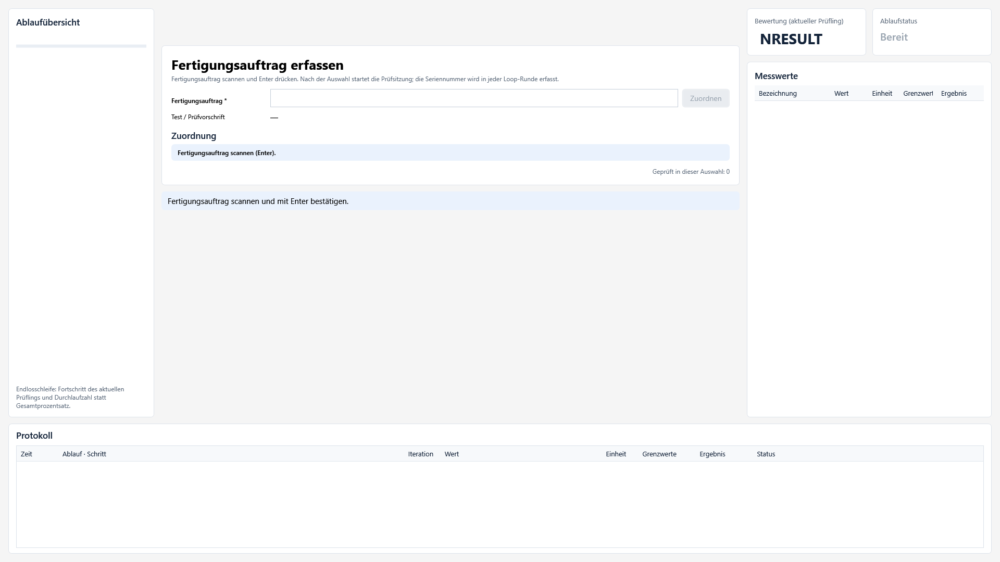

# Testumgebung

Testumgebung ist eine Windows-Anwendung für Prüfplätze in Fertigung und Labor. Werker führen freigegebene Prüfprogramme aus und sehen die Ergebnisse direkt am Prüfplatz. Prüfentwickler erstellen und simulieren Abläufe, binden Geräte an und bereiten Prüfprogramme zur Freigabe vor.



## Schnellstart

1. Das signierte MSIX-Paket aus den GitHub-Releases installieren. [Downloads](https://github.com/bugtesterdani/Testumgebung/releases) · [Installation und Voraussetzungen](docs/msix-release.md)
2. Zum Ausprobieren ohne Hardware die Anwendung aus dem Repository mit dem simulierten Auftragsbeispiel starten. Dafür wird das .NET 10 SDK benötigt.

   ```powershell
   dotnet run --project src/Testumgebung.Desktop -- --development --example-order
   ```

3. In **Prüfen** den Beispielauftrag `A123` bestätigen und unten rechts **Start** wählen. Für den produktiven Prüfplatzstart sind die lokale Prüfplatzkonfiguration und ein freigegebenes Prüfprogramm maßgeblich. [Betriebsmodus](docs/betriebsmodus-und-laufzeit.md)

## Handbücher

- [Benutzerhandbuch](docs/handbuch/benutzerhandbuch.md)
- [Werkerhandbuch](docs/handbuch/werker.md)
- [Entwicklerhandbuch](docs/handbuch/entwickler.md)
- [Administratorhandbuch](docs/handbuch/administrator.md)
- [Geräte und Treiber](docs/geraete.md)

## Projekt und Releases

Die [Entwicklungsetappen](CHANGELOG.md) dokumentieren den Ausbau der Anwendung. Die Änderungen je Version stehen bei den [GitHub-Releases](https://github.com/bugtesterdani/Testumgebung/releases). Änderungen an `main` erfolgen über Pull Requests. [Release-Ablauf](docs/release-ablauf.md) · [GitHub-Einrichtung und Wiki](docs/github.md) · [Beiträge](CONTRIBUTING.md)

Das Skript `Report-Coverage.cmd` erstellt einen datierten HTML-Bericht zur Testabdeckung. [Testabdeckung und Wartbarkeit](docs/testabdeckung-und-wartbarkeit.md) · [Komplexitätsdurchsicht](docs/komplexitaetsdurchsicht.md)

[Datenschutz](docs/datenschutz.md) · [Sicherheitsmeldungen](SECURITY.md) · [Lizenz-Prüfbericht](docs/licensing/pruefbericht.md) · [Abhängigkeitsinventar](docs/licensing/inventar.md) · [Hinweise zur Veröffentlichung](docs/github-veroeffentlichung.md)


## Bauen und testen

Voraussetzung: .NET 10 SDK.

```powershell
dotnet build Testumgebung.sln
dotnet test  Testumgebung.sln
```

Datenbank-Vertragstests gegen echte Server laufen zusätzlich, wenn Verbindungsstrings gesetzt sind (sonst übersprungen):

```powershell
$env:TESTUMGEBUNG_TEST_MSSQL    = "Server=(localdb)\MSSQLLocalDB;Database=TuTest;Integrated Security=true;TrustServerCertificate=true"
$env:TESTUMGEBUNG_TEST_POSTGRES = "Host=localhost;Database=tu_test;Username=postgres;Password=…"
$env:TESTUMGEBUNG_TEST_MYSQL    = "Server=localhost;Database=tu_test;User ID=root;Password=…"
dotnet test Testumgebung.sln --filter DatabaseAdapterTests
```

Die Datenbanken müssen existieren (z. B. `CREATE DATABASE tu_test`); die Tabellen legt der Test selbst an.

## Aufbau

```text
src/
  Testumgebung.Contracts   ResultRating, RunStatus, EngineState, VarType/TypedValue, IClock (+VirtualClock),
                           IResourceManager, IHardwareAdapter, ResourceBinding
  Testumgebung.Domain      GroupDefinition/StepDefinition/TestDefinition, Repetition, Scope (Namenssuche, ../),
                           typisierte Ausdruckssprache, PendingResult/ResultAccumulator, IStepAction/IStepContext
  Testumgebung.Hardware    ResourceManager (atomar, FIFO-fair, Referenzzählung, Timeout), SimulationAdapter, HardwareRegistry
  Testumgebung.Engine      TestRun (Ausführungsstack, Wiederholung, Exit/Abbruch, Haltepunkte, gezielte Ausführung),
                           DebugController, Ausführungsereignisse, Bausteinkatalog (Blocks/BlockCatalog)
  Testumgebung.Persistence Projektdateien (JSON, *.tproj.json), Beispielprojekt, Simulationsaufbau,
                           Results/: Recorder, Filter, Ergebnisdatei .tres (MessagePack, CRC, Index), Outbox, DB-Vertrag,
                           Curves/: Import CSV/Text, COMTRADE, Excel, Ergebnisdatei; Releases/: Pakete, Audit;
                           Stations/: Prüfplatzkonfiguration, Gerätepool, Konfigurationsprüfung, StationCoordinator
  Testumgebung.DatabaseAdapters  SQL-Dialekte, Migration, SqlRunDatabase (ADO.NET), Vertragsprüfung – ohne Treiberabhängigkeit
  Testumgebung.Notifications     MQTT-3.1.1-Client (TLS, QoS 0) und MqttNotifier
  Testumgebung.Instruments       SCPI (Socket/VISA), Keysight/Agilent-Treiber, NI-DAQmx (C-API), Gerätesimulatoren
  Testumgebung.Identity          Anmeldung (IIdentityProvider, simuliert), Zugangsdatei, Rechte, SessionService
  Testumgebung.Presentation ViewModels ohne WPF-Abhängigkeit (Shell, Prüfplatz, Editor, Debugger, Bibliothek, Einstellungen,
                           Auswahl & Auftrag, System & Sicherung) – testbar; Pilot/: Systemprüfung, Konfigurationssicherung
  Testumgebung.Workers     Host-Seite der Code-Worker (Prozess, Protokoll, Pool, Abbruch) + python/worker.py
  Testumgebung.Workers.CSharp  Isolierter .NET-Worker (Roslyn)
  Testumgebung.Workers.Native  Isolierter C++-Worker (Toolchain-Erkennung, Build-Cache, DLL laden, C-ABI) – auch für LabVIEW
  Testumgebung.Desktop     WPF-Oberfläche (Windows)
tests/
  Engine.Tests             Abnahmetests aus Abschnitt 14 (xUnit)
docs/adr/                  Entscheidungen zu den „Vorschlag“-Punkten
docs/sql/                  Referenz-Schemaskripte je Datenbanksystem
build/CodeWorkers.targets  kopiert die Worker nach bin\…\workers\ (Desktop und Tests) und beim Veröffentlichen mit
build/publish.ps1          Tests, Veröffentlichung win-x64, Prüfsummen, Installer (installer/Testumgebung.iss, Inno Setup 6)
docs/handbuch/             Handbücher für Werker, Entwickler, Administrator
docs/pilot/                Abnahmeprotokoll der Pilotstation
```

## Minimalbeispiel

```csharp
var dut = new GroupDefinition("dut", "Prüfling") { IsDutRun = true }
    .Var("Kennung", VarType.String, "SN-10482")
    .Var("Spannung", VarType.Double)
    .Add(Steps.Measure("u", "Messung Spannung", "Spannung_Pruefling", "Spannung", 220, 240, "V"));

var loop = new GroupDefinition("loop", "Test Loop / Testing") { Repetition = Repetition.Endless }.Add(dut);
var def  = new TestDefinition("AC-Prüfung", "1.5",
    new GroupDefinition("init", "Test Start / Init"), loop, new GroupDefinition("fin", "Test End / Finalization"));

var sim = new SimulationAdapter();
sim.SetInput("ai0", 230.1);
var run = new TestRun(def, new TestRunOptions { Hardware = new HardwareRegistry().Bind("Spannung_Pruefling", sim, "ai0") });
run.EventRaised += e => Console.WriteLine(e);
var task = Task.Run(run.RunAsync);
// … später: Werkerabbruch
run.RequestAbort();
RunStatus status = await task;   // z. B. "PASS + WERROR"
```

## Abgedeckte Abnahmetests

| ID | Test |
|---|---|
| E01 | `ScopeAndExpressionTests.E01_*`, `ExecutionTests.E01_*` |
| E02 | `ExecutionTests.E02_*` |
| E03–E06 | `ExecutionTests.E03_*` … `E06_*` |
| E07–E09 | `AbortAndExitTests.*` |
| D01–D05 | `DebugTests.D01_*` … `D05_*` |
| D06 | `DebugTests.D06_*` (Variablen), `RunPatchTests.*` (Parameter-/Code-Patch eines nicht aktiven Knotens) |
| L01–L02 | `ResourceTests.L01_*`, `L02_*` (zwei Prüfplätze, virtuelle Uhr), `ParallelTests.Timeout_*` |
| P01–P05 | `ResultStorageTests.P01_*` … `P05_*`, mit echter Datenbank: `DatabaseAdapterTests.P02_P04_P05_*`, `SettingsTests.Ende_zu_Ende_*` |
| P06 | `MqttNotifierTests.P06_*` |
| A01 | `IdentityAndReleaseTests.A01_*` |
| V01 | `IdentityAndReleaseTests.V01_*` |
| W01 | `CurveTests.W01_*` (drei Wege, drei Phasen: Zeitbasis, Kanalzuordnung und Version reproduzierbar) |

Zusätzlich: Wiederholungsarten (Solange, Bis, Zeitspanne, endlos), Bedingungsdiagnosen, Pflicht-Kennung,
Abbruch beim Warten auf Ressourcen, Referenzzählung, faire Ressourcenvergabe, Abbruch während Haltepunkt.

Etappe 3 zusätzlich: `ProjectAndOperatorTests` (JSON-Rundreise, Katalogbausteine, Werkerinteraktion inkl.
Validierung und Anzeigedauer) und `PresentationTests` (Editor: Einfügen/Verschieben/Ein-/Ausrücken/Löschen,
Eigenschaften mit Validierung, Speichern/Öffnen; Prüfplatz: kompletter Prüflingsdurchlauf mit Eingaben,
Werkerabbruch mit Exit-Folge, Debugger mit Variablenänderung, gezielte Ausführung, geteilte AC-Quelle).

Etappe 4: `CodeBlockTests` (beide Sprachen: Compilerdiagnosen mit Zeile, Ordnervariablen lesen/schreiben,
Hardware über die zentrale Vermittlung inkl. Lock-Prüfung, Ausnahmen → ERROR mit Zeile, Werkerabbruch kooperativ
und per Prozessabbruch, Bibliotheksbaustein mit Bindungen und Bausteingrenze, Werkereingabe aus dem Code,
Umwandeln mit gleichem Verhalten, Speicherung) und `CodeEditorTests` (Build im Editor, Umwandeln und Ausführen am
Prüfplatz, Bibliothek mit Build/Test, Löschschutz).

Etappe 4 (Nachtrag): `CppAndLabViewTests` (C++: Diagnosen mit Zeile, Variablen, Hardware, Ausnahmen, Abbruch;
LabVIEW: Connector mit Test-DLL, fehlende DLL → ERROR mit Diagnose; werden übersprungen, wenn kein C++-Compiler
gefunden wird), `GroupBlockTests` (Port-Erkennung, gleiches Verhalten nach Umwandlung, Speicherung, Editor) und
`RunPatchTests` (nur bei Pause, aktive Knoten gesperrt, Wirkung nur im laufenden Durchlauf).

Etappe 5: `ResultStorageTests` – P01–P05 (siehe Tabelle) sowie verlustfreie Rundreise inkl. Kurven ohne Testversion,
dreiphasige Kurven mit gemeinsamer Zeitbasis, blockweise große Kurven mit expliziten Zeitpunkten, beschädigte und
abgeschnittene Dateien, atomares und kollisionsfreies Speichern mit Wiederherstellung, Anhang-Deduplizierung,
Gruppendefaults/Overrides, Filter im Editor, Outbox enthält genau die DB-Auswahl, defekte Outbox-Einträge, Ergebnisseite.

Etappe 6: `DatabaseAdapterTests` (SQLite über die native Bibliothek: Vertragsprüfung, Migration, echter Prüfling mit
Kurven und typisierten Messwerten, Outbox mit Ausfall/Neustart/Antwortverlust; alle vier Dialekte: vollständige Skripte
und Parameter; Referenzskripte aktuell; SQL Server/PostgreSQL/MySQL mit Verbindungsstring), `MqttNotifierTests`
(Nachrichteninhalt, QoS 0, P06, abgelehnte Anmeldung, voller Puffer, TLS mit Firmen-CA und Hostnamenprüfung) und
`SettingsTests` (geschützte Geheimnisse, Ende zu Ende Prüfplatz → Datenbank → MQTT mit Ausfall und Nachreichen,
Verbindungstest, Vertragsprüfung, Testmeldung).

Etappe 7: `IdentityAndReleaseTests` (Paket mit Bereichshashes und Manipulationserkennung, Hash-Kette des Audit-Logs,
Rechte getrennt/kombiniert und Freigaberegeln in Ordner- und SQLite-Ablage, paralleles Audit-Schreiben, A01 Anmeldung
während der Messung mit Kontowechsel und Abmeldung, Ablehnung unbestätigter/fremder/rechteloser Konten, Zugangsdatei
und Inaktivitätssperre, Werkerbetrieb nur mit Freigabe, V01 Versionswechsel am nächsten Prüfling bzw. Neustart).

Etappe 8: `CurveTests` (Generator dreiphasig mit gemeinsamer Zeitbasis, Formeln, Bearbeitung mit Historie ohne
automatische Konvertierung, unveränderliche Versionen in Projekt und Release-Paket inkl. Manipulationserkennung,
Import CSV mit Einheiten/expliziter Zeit/Qualitätscodes, COMTRADE ASCII/BINARY/FLOAT32, Excel mit gemeinsamen
Zeichenfolgen, Messkurve aus Ergebnisdatei mit unverändertem Original, Geräteeignung, Reihenfolge Laden → Übertragen →
Starten → Stoppen, W01; Oberfläche: Kurvenanzeige mit Zoom/Cursor/Effektivwert, Kurvenseite mit allen drei Wegen,
Versionierung und Testausgabe) sowie Kurvenanzeige der Werkeransicht in `PresentationTests`.

Etappe 9: `ParallelTests` (Abnahme: zwei Prüfplätze mit je sechs Prüflingen und gemeinsamer AC-Quelle unter
verschiedenen Namen ohne widersprüchlichen Zugriff, Gegenprobe ohne Sperre, Zeitlimit mit Besitzer in der Meldung,
Zyklusrisiko statisch und Startverweigerung, Laufzeit-Verklemmung → ERROR, Konfigurationsprüfung, Datei beschädigt,
Konfigurationsseite mit Live-Status, Prüfplatz anlegen/speichern, Werkerabbruch eines Prüfplatzes).

Etappe 10: `InstrumentTests` (Ressourcen → Socket/VISA, Multimeter/Netzgerät/AC-Quelle über SCPI mit
Fehlerwarteschlange und Bereichsprüfung, Generator-Kurvenausgabe und synchrone Oszilloskop-Aufnahme mit Phasenlage,
Abbruch während einer Messung und Zeitlimit mit wiederverwendbarer Sitzung, NI-DAQmx Einzelwerte/Aufnahme/Ausgabe/
Trigger/Abbruch/sicherer Zustand, Ablauf mit realen Treibern inklusive Werkerabbruch und sicherem Zustand,
Konfigurationsseite mit Laborsimulatoren und Gerät testen).

## Bausteine (Palette)

Messung, Ausgabe setzen, Digitaleingang lesen, Digitalausgang setzen, Wert setzen, Bewertung (Bedingung),
Bewertung (Bedingung oder festes Ergebnis), Warten, Werkerinteraktion (Anweisung, Bild mit Bestätigung, Eingabe, Auswahl;
Pflicht, Bereich, erlaubte Werte, warten/fortsetzen, „bis Gruppenende sichtbar“). Grenzwerte und Werte sind
typisierte Ausdrücke, z. B. `GrenzwertMin` oder `Nennspannung * 1.05`.

CodeBlocks: CodeBlock (C#/Python/C++ im Ablauf), Baustein (aus der Bibliothek, zusätzlich LabVIEW) und
Grafischer Baustein (aus einer Gruppe).

Kurve aufnehmen: mehrere Kanäle eines Geräts mit gemeinsamer Zeitbasis (z. B. L1/L2/L3), optional Bewertung des
Effektivwerts je Kanal; die Kurven landen als binäre Chunks in Ergebnisdatei und Datenbank.

Kurvenausgabe: Aktion Laden (mit Geräteeignungsprüfung), Übertragen, Starten oder Stoppen. Die Reihenfolge wird vom Gerät erzwungen; das Beispielprojekt gibt `AC_Profil` v0.4 in Init aus und
stoppt in der Finalization.

Kommunikation: Senden, Empfangen, Abfrage, Modbus lesen/schreiben, CAN senden/empfangen, CAN-Signal lesen (DBC),
CAN-Botschaft senden (DBC), UDS-Diagnose (CAN/DoIP/LIN), J1939 empfangen/senden/Adresse beanspruchen, LIN lesen/senden, LIN-Fahrplan, UDS-Sicherheitszugang, DoIP Fahrzeugsuche.

Auswahl & Auftrag: Test auswählen (Ausgabevertrag des eigenen Auswahlablaufs: Testkennung, Version, Auftrag, Prüfparameter).

Kommunikation: `CommunicationTests` (Text/Hex, Modbus-Datentypen/CRC, CAN-Signale, Bausteine gegen die Simulation,
Reservierung, TCP-Textprotokoll, Modbus TCP gegen Simulatorserver, Modbus RTU mit CRC-Fehler und Wiederholung, virtueller
CAN-Bus mit FD und Filter, Prüfplatzkonfiguration).

Plan-Lücken und Pilot: `SelectionTests` (Kennungsmuster, Priorität, Mehrdeutigkeit, manuelle Auswahl, eigener Ablauf über den
Baustein und über einen einzigen CodeBlock mit `SelectTest`/`select_test`, Vorbelegung und Prüflingsanzahl in der Engine,
Werkerpanel mit genau einem Prüfling und Werkerabbruch, Konfigurationsseite),
`OperatorLayoutTests` (Layout im Projektformat, Fortschrittsposition, ausgeblendete Übersicht/Protokoll/Schritte, nur
auffällige Messwerte), `RecoveryTests` (Journal bei Absturz, Wiederherstellung als ERROR mit Filtern, Löschen nach
Speicherung, abgeschnittene Zeile, Verwerfen), `PilotTests` (Systemprüfung, Sicherung/Wiederherstellung mit Prüfsummen).

Auswertung, Editor, Abschnitt 15: `ReportTests` (Kennzahlen, Pareto, Cpk, CSV, PDF-Struktur und -Inhalt, mehrseitig),
`EditorComfortTests` (Rückgängig/Wiederholen, Kopieren/Einfügen mit neuen IDs, Suche, Versionsvergleich),
`OpenPointsTests` (Zeitspanne innerhalb der Iteration, Einzel-/Prozedurschritt/bis Gruppenende, App-Rollen).

Busdatenbanken, Diagnose, LIN: `BusTests` (DBC mit Multiplex/Wertetabellen/Gleitkomma/J1939, LDF, LIN-Prüfsumme, Signal-
und Botschaftsbausteine, UDS mit Segmentierung/NRC/„Antwort folgt“, J1939 Anforderung/BAM/RTS-CTS, LIN, Editor-Diagnose,
Import, ISO-TP/J1939 zwischen zwei Treiberinstanzen am virtuellen Bus, CodeBlocks in Python/C#/C++).

Weitere Meldewege, DB-Auswertung, Diagnoseausbau: `NotifierTests` (HTTP-Webhook gegen einen Test-Server, mehrere Meldewege,
OPC-UA-Optionen), `DatabaseAdapterTests` (Lesen aus SQLite mit Filtern), `ReportTests` (Auswertung aus der Datenbank),
`RecoveryTests` (Zurückkopieren aus dem Wiederherstellungsordner), `BusTests` (DoIP, erweiterte ISO-TP-Adressierung,
J1939-Adressanspruch, LIN-Fahrplan und UDS über LIN). Sicherheitszugang, Dreiphasenquelle, DoIP-Suche/TLS, DB-Kurven:
`BusTests` (Seed/Key gegen die Simulation), `InstrumentTests` (dreiphasige AC-Quelle), `DoIpAndTlsTests` (DoIP-Suche über UDP,
TCP mit TLS gegen ein Selbstzertifikat), `DatabaseAdapterTests` (Lauf mit Kurven aus SQLite). Run-Patch Teil 2 und OPC UA:
`RunPatchTests` (Bibliotheksbaustein-Quelltext und Struktur nicht aktiver Gruppen), `OpcUaTests` (Baustein und Python-CodeBlock
Lesen/Schreiben/Methode/Abo gegen den Simulationsserver, Fehlerfälle). Quellcode-Debugger: `CodeDebugTests` (Python-, C#- und
C++-Zeilen-Stepping mit Variablen – C++ bei vorhandener Toolchain, „bei Eintritt halten“, Stopp-Befehl, haltepunktfreier Lauf).

Installierbares MSIX-Bundle: `Release-MSIX.cmd` starten und eine neue Version eingeben. Anleitung: [MSIX-Release](docs/msix-release.md).

Eigene C#-Bibliotheken: [Handbuch zur DLL-Schnittstelle, Auftragsauswertung und Prüffunktionen](docs/handbuch-csharp-dll.md).

Versionierte Prüfprogramme: [Git/SVN, zentrale Freigaben und Platzzuordnung](docs/versionierte-pruefprogramme.md).

Ausführliche Bedienung mit Bildern: [Benutzerhandbuch](docs/handbuch/benutzerhandbuch.md).

Dynamische COM-Ports und Netzwerkverbindungen: [Anleitung mit Variablen, SSH, SFTP, HTTP und Telnet](docs/dynamische-verbindungen.md). Geräteadressen können während des Prüfprogramms aus aktuellen Variablen gesetzt werden. Die Protokolle sind direkt eingebunden; externe ssh-/sftp-/curl-Programme sind dafür nicht erforderlich.

Noch offen: Abnahme an der Pilotstation mit realer Hardware (`docs/pilot/abnahmeprotokoll.md`).


## Lizenz

Der eigene Code steht unter [MIT](LICENSE). Fremdkomponenten behalten ihre eigenen
Lizenzen. Siehe [Maßnahmen zur Lizenzprüfung](docs/licensing/massnahmen.md),
[Inventar](docs/licensing/inventar.md) und [Weitergabebedingungen](THIRD-PARTY-TERMS.md).
Für neue Veröffentlichungen werden NuGet-Lockdateien verwendet; CI bricht bei
ungeplanten Abhängigkeitsänderungen ab. Historische MSIX-Versionen bis 1.0.12.x
sind nicht durch die Nachprüfung der Version 1.0.13.3 freigegeben.

Quellcode-Referenz und sichtbare Dokumentationslücken: `Report-Doxygen.cmd`. [Anleitung und Lizenzentscheidung](docs/code-dokumentation.md).

Prüfprogramme mit KI übertragen: [Anleitung, Konvertierungsauftrag, Bausteinkatalog und geprüftes Beispiel](docs/ki-testprogramme.md).

Ohne Oberfläche prüfen, bauen und mit Szenarien simulieren (CI, KI-Agenten in einer Offline-VM): [Kommandozeile `testumgebung-cli`](docs/kommandozeile.md).

Externe EXE-, Python- und .NET-DLL-Aufrufe im Prüfprogramm: [Prozesse, Lebensdauer und Exitcode-Auswertung](docs/externe-prozesse.md).
