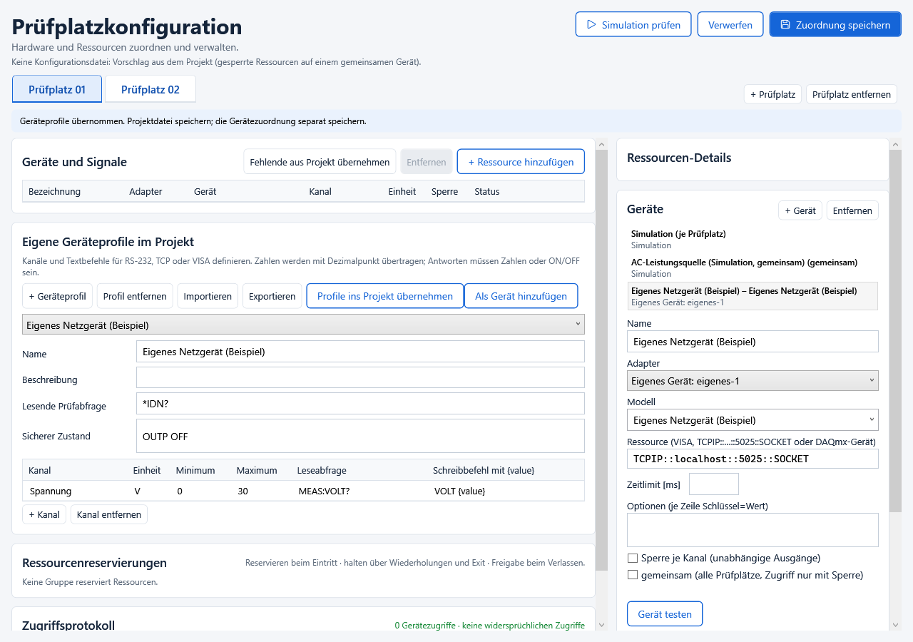

# Eigene Geräte im Projekt

In der **Prüfplatzkonfiguration** befindet sich der Abschnitt **Eigene Geräteprofile im Projekt**. Dort lassen sich eigene Geräte mit numerischen Kanälen und Textbefehlen definieren. Die Definition wird in der `.tproj.json`-Projektdatei gespeichert und mit einem Programmrelease übernommen. Es ist keine Änderung am Anwendungscode erforderlich.

## Ein Geräteprofil anlegen

1. **+ Geräteprofil** anklicken und einen verständlichen Namen vergeben.
2. Mit **+ Kanal** die Messwerte und Einstellwerte anlegen. Kanalname, Einheit, Minimum und Maximum eintragen.
3. Die **Leseabfrage** aus dem Gerätehandbuch eintragen, beispielsweise `MEAS:VOLT?`. Leer lassen, wenn der Kanal ausschließlich geschrieben wird.
4. Den **Schreibbefehl** eintragen, beispielsweise `VOLT {value}`. `{value}` wird durch den Zahlenwert ersetzt. Leer lassen, wenn der Kanal ausschließlich gelesen wird.
5. Optional eine **lesende Prüfabfrage** wie `*IDN?` eintragen. „Gerät testen“ sendet ausschließlich diese Abfrage. Ohne Prüfabfrage wird keine bestätigte Geräteidentität gemeldet.
6. Für Ausgabegeräte im Feld **Sicherer Zustand** die Abschaltbefehle eintragen, beispielsweise `OUTP OFF`; ein Befehl pro Zeile. Die bestehende Geräteabschaltung verwendet diese Befehle. Ohne Abschaltbefehle meldet sie bei schreibbaren Kanälen einen nicht bestätigten sicheren Zustand.
7. **Profile ins Projekt übernehmen** anklicken und die Projektdatei über die Projekt-Speicherfunktion speichern. Die Übernahme ist während einer laufenden Prüfung gesperrt.

Die Befehle in der Abbildung sind Beispiele. Welche Befehle ein konkretes Gerät benötigt, steht in dessen Kommunikationshandbuch. Es werden keine zusätzlichen Initialisierungs- oder Fehlerabfragen automatisch gesendet.

Mit **Exportieren** ein Profil als `.tdevice.json` speichern. In einem anderen Projekt über **Importieren** laden und anschließend **Profile ins Projekt übernehmen**. Der Import legt ein neues Profil an und ersetzt kein bereits verwendetes Profil.

## Anschließen und im Prüfprogramm verwenden

1. Das Profil auswählen und **Als Gerät hinzufügen** anklicken. Alternativ unter **Geräte → + Gerät** den Adapter `Eigenes Gerät: …` auswählen. Ein Profil kann für mehrere Geräte mit unterschiedlichen Anschlussadressen verwendet werden.
2. Rechts die Anschlussadresse eintragen:
   - RS-232: `COM4`. Optionen beispielsweise `Baud=9600`, `Datenbits=8`, `Parität=N`, `Stoppbits=1`, `Zeilenende=CRLF`, jeweils auf einer eigenen Zeile. Zeilenende unterstützt `LF`, `CR` und `CRLF`.
   - TCP: `TCPIP::192.168.1.20::5025::SOCKET` oder `192.168.1.20:5025`. Textbefehle enden mit LF.
   - VISA: die VISA-Ressource, beispielsweise `USB0::…::INSTR`. Hierfür wird weiterhin ein passender VISA-Treiber auf dem Rechner benötigt.
3. Unter **Geräte und Signale** eine Ressource anlegen, beispielsweise `Versorgung`, und ihr das eigene Gerät sowie den passenden Kanal zuordnen.
4. Konfiguration prüfen und **Zuordnung speichern**. Die Anschlussadresse und Ressourcenzuordnung gelten für diesen Rechner; das portable Befehlsprofil gehört zum Projekt.
5. Im Prüfprogramm die bestehenden Mess- und Schreibbausteine mit der Ressource `Versorgung` verwenden. In einem C#-Baustein stehen dafür beispielsweise `Read("Versorgung")` und `Write("Versorgung", 12)` zur Verfügung. Gemeinsame Geräte benötigen weiterhin die vorhandenen Ressourcenreservierungen und Sperren.

## Antworten und Grenzen

Lesende Kanäle erwarten eine einzelne endliche Zahl mit Dezimalpunkt; wissenschaftliche Schreibweise ist erlaubt. `ON` und `OFF` werden als 1 und 0 gelesen. Antworten wie `12 V`, JSON oder Binärdaten werden nicht automatisch interpretiert. Schreibwerte außerhalb der festgelegten Grenzen sowie NaN und Unendlich werden abgelehnt; sie werden nicht automatisch begrenzt.

Die Profile unterstützen einzelne numerische Werte über Textprotokolle. Binäre Protokolle, proprietäre USB-Treiber, Kurvenübertragung und mehrstufige Antwortauswertung benötigen einen spezifischen Treiber oder die vorhandenen Kommunikations-/Codebausteine.

Nach Änderungen an einem Profil erneut **Profile ins Projekt übernehmen** und die Projektdatei speichern. Bereits freigegebene Programmversionen behalten ihre eigene gespeicherte Definition. Ein Profil kann erst entfernt werden, wenn kein Gerät im Konfigurationsentwurf mehr auf dieses Profil verweist.
