# Benutzerhandbuch Testumgebung

Eigene Geräte lassen sich im Projekt definieren: [Anleitung und Beispiel](../eigene-geraete.md).

**Grundhandbuch: 10.10.2026 · Ergänzung zwei Prüfplätze: 12.10.2026 / 1.0.10.0**

Die neue gemeinsame Werkeransicht mit zwei Prüfplätzen, gemeinsamem Fertigungsauftrag und konfigurierbarer Freigabe ist in [Zwei Prüfplätze](../zwei-pruefplaetze.md) mit Abbildung und Beispielprogramm vollständig beschrieben.

Die neuen Netzteiltreiber sind in [Chroma 61602 und ET EAQ-1000](../chroma-und-eaq.md) erklärt, einschließlich RS-232-Einstellungen und des dokumentierten Funktionsumfangs.

Dieses Handbuch führt von der Installation bis zur täglichen Prüfung. Es richtet sich an Werker, Entwickler und Administratoren. Die Beispiele verwenden Fertigungsaufträge A123 bis D123 und die Programme A bis D. Für den produktiven Einsatz werden diese Beispiele durch die eigenen Auftragsregeln, Geräte und freigegebenen Prüfprogramme ersetzt.

Die Abbildungen wurden aus den tatsächlichen WPF-Ansichten mit einer Beispielkonfiguration erzeugt. Sie zeigen einzelne Seiten ohne den äußeren Fensterrahmen. Leere Ergebnislisten und „Noch nicht geprüft“ sind bewusst unbelegte Zustände, keine nachgewiesenen Produktionsprüfungen. Graue Schaltflächen können fehlende Anmeldung, fehlende Auswahl oder einen nicht passenden Ablaufzustand anzeigen. Die Bilder sind Orientierungshilfen; ein Hardware- oder Datenbanknachweis ist damit nicht verbunden.

## Inhalt

1. [Grundbegriffe und Arbeitsablauf](#1-grundbegriffe-und-arbeitsablauf)
2. [Installation und Start](#2-installation-und-start)
3. [Orientierung und Anmeldung](#3-orientierung-und-anmeldung)
4. [Prüfen als Werker](#4-prüfen-als-werker)
5. [Prüfprogramm im Ablaufeditor erstellen](#5-prüfprogramm-im-ablaufeditor-erstellen)
6. [CodeBlocks und Bibliotheksbausteine](#6-codeblocks-und-bibliotheksbausteine)
7. [Eigene C#-DLL einbinden](#7-eigene-c-dll-einbinden)
8. [Auftragsauswahl vor dem Prüfprogramm](#8-auftragsauswahl-vor-dem-prüfprogramm)
9. [Prüfplätze und Geräte einrichten](#9-prüfplätze-und-geräte-einrichten)
10. [COM und Netzwerkkommunikation](#10-com-und-netzwerkkommunikation)
11. [Simulation und Debugger](#11-simulation-und-debugger)
12. [Testprogramme freigeben](#12-testprogramme-freigeben)
13. [Ergebnisse und Berichte](#13-ergebnisse-und-berichte)
14. [Kurven verwenden](#14-kurven-verwenden)
15. [Einstellungen, Sicherung und Betrieb](#15-einstellungen-sicherung-und-betrieb)
16. [Ein vollständiges Beispiel von A123 bis zum Ergebnis](#16-ein-vollständiges-beispiel-von-a123-bis-zum-ergebnis)
17. [Fehler finden und beheben](#17-fehler-finden-und-beheben)
18. [Weiterführende Anleitungen und Bilddateien](#18-weiterführende-anleitungen-und-bilddateien)

## 1. Grundbegriffe und Arbeitsablauf

| Begriff | Bedeutung |
| --- | --- |
| Prüfplatz | Ein Arbeitsplatz mit eigener Gerätezuordnung, Start, Status und Werkerabbruch |
| Prüfprogramm / Projekt | Ein gespeicherter Ablauf mit Variablen, Schritten, Bibliothek und eingebetteten Dateien |
| Auswahlprojekt | Separater Ablauf, der einen Fertigungsauftrag auswertet und das Prüfprogramm bestimmt |
| Fertigungsauftrag | Auftrag für eine Prüfsitzung, z. B. A123 |
| Seriennummer / Kennung | Identität eines einzelnen geprüften Geräts; wird jeder Loop-Runde neu zugeordnet |
| CodeBlock | Quelltextschritt direkt im Ablauf; sieht die verfügbaren Variablen seines Bereichs |
| Bibliotheksbaustein | Wiederverwendbarer Code mit ausdrücklich definierten Eingängen und Ausgängen |
| DLL | Kompilierte .NET-Bibliothek, deren öffentliche Methoden aus C# aufgerufen werden |
| Ressource | Abstrakter Name im Programm, z. B. `Pruefling_Seriell`; wird am Prüfplatz einem Gerät zugeordnet |
| Testprogrammfreigabe | Geprüfter, versionierter Stand eines Prüfprojekts |
| MSIX-Release | Installationspaket der Software selbst, z. B. 1.0.3.0 |

Der gewünschte Auftragsmodus arbeitet so:

```text
Fertigungsauftrag scannen
  → Auswahlprojekt ausführen und Programm bestimmen
  → Start/Init einmal ausführen
  → Loop: neue Seriennummer erfassen, prüfen und Ergebnis zuordnen
  → Loop mit nächster Seriennummer wiederholen
  → Werkerabbruch: End/Finalization und Abschluss abwarten
  → Fertigungsauftrag erneut scannen
```

Ein Auftrag darf viele Prüflinge umfassen. Eine Seriennummer gehört zu einem einzelnen Prüfling. Die Programmwahl findet vor Start statt. Start ist nicht der richtige Ort, um erst das noch unbekannte Prüfprogramm auszuwählen.

## 2. Installation und Start

### 2.1 MSIX installieren oder aktualisieren

1. Alle Fenster der Testumgebung schließen.
2. Das öffentliche Signierzertifikat prüfen. Bei den lokal erzeugten Test-Releases muss Windows diesem Zertifikat vertrauen. Die genaue Installation erfolgt nach der [MSIX-Anleitung](../msix-release.md).
3. Die `.msixbundle`-Datei öffnen und die angebotene Installation oder Aktualisierung durchführen.
4. Die Software über das Startmenü starten.

Das x64-MSIX bündelt die .NET-Laufzeit, C#- und C++-Worker sowie C++-Compiler und GDB. Python 3.14.8 einschließlich Standardbibliothek ist portabel enthalten und wird von Python-CodeBlocks automatisch verwendet. Unter **System & Sicherung → Python-Umgebung und Konsole** lässt sich eine beschreibbare temporäre Kopie erstellen. Die Konsole zeigt vorbereitete pip-Befehle; anschließend aktiviert **Diese Umgebung verwenden** die Kopie für Python-Bausteine. Die [Python-Anleitung](../portable-python.md) beschreibt die Schritte, Paketinstallation und Rückkehr zur mitgelieferten Laufzeit. Herstellerabhängige Hardware kann zusätzliche Treiber wie VISA oder NI-DAQmx benötigen.

Je ausgewähltem Testprogramm gilt: **Umgebung aus dem Auswahlprogramm → String-Variable `PythonVenv` → allgemeine Vorgabe aus Registry → Python aus MSIX**. Fehlende Umgebungen werden übersprungen. Die Auswahl erfolgt mit `SelectTest(..., pythonVenv: pfad)` oder im Baustein „Test auswählen“ über „Python-Umgebung (optional)“. Die [Beispiele zur Programmauswahl](../portable-python.md#python-je-ausgewähltem-testprogramm-festlegen) erklären alle Varianten einschließlich einer Änderung im Start-/Init-Abschnitt.

### 2.2 Normalbetrieb und Beispielbetrieb

Im Startmenü gibt es „Testumgebung“ für den normalen Betrieb und „Testumgebung – Beispiele A bis D“ für den lokalen Entwicklungs-/Simulationsmodus. Im Quellprojekt startet `Start-Programme.cmd` beziehungsweise `Start-A123.cmd` ebenfalls die Beispiele.

Die Beispieldaten bedeuten A123 → Programm A, B123 → Programm B, C123 → Programm C und D123 → Programm D. Der Beispielbetrieb ist für das Kennenlernen geeignet. Er richtet keine Produktionsfreigaben oder echten ERP-Daten ein.

**Erfolgskontrolle:** Die Anwendung öffnet sich. Im Beispielbetrieb lässt sich ein Auftrag zuordnen. Für echte Hardware und produktive Freigaben wird die normale Konfiguration eingerichtet.

## 3. Orientierung und Anmeldung

Oben im Fenster den gewünschten Prüfplatz auswählen. Die Navigation links öffnet die verschiedenen Arbeitsbereiche. Der ausgewählte Prüfplatz bleibt für seine Prüfung maßgeblich.

| Seite | Dort erledigen Sie |
| --- | --- |
| Prüfen / Werkeransicht | Auftrag und Seriennummer erfassen, Anweisungen beantworten, Ergebnisse beobachten |
| Ablaufeditor | Projekt öffnen, Schritte einfügen, Variablen und Ablauf ändern |
| CodeBlocks | Wiederverwendbare Bausteine erstellen, DLLs importieren, Schnittstellen prüfen |
| Prüfplatzkonfiguration | Geräte und abstrakte Ressourcen zuordnen |
| Auswahl & Auftrag | Eigenen Auswahlablauf, Kennungsregeln und Auftragsmodus konfigurieren |
| Releases | Prüfprogramme versionieren, prüfen und freigeben |
| Ergebnisse | Einzelne Ergebnisdateien und Wiederherstellung ansehen |
| Auswertung | Ergebnisse filtern, Kennzahlen und Berichte erstellen |
| Kurven | Kurven importieren, untersuchen und verwenden |
| Debug | Haltepunkte und Einzelschritte während der Entwicklung nutzen |
| Einstellungen | Ergebnisablage, Datenbank und Meldewege einstellen |
| System & Sicherung | Systemprüfung, Sicherung und Wiederherstellung |

Werker benötigen für den normalen Prüfablauf keine Entwickleranmeldung. Änderungen und Freigaben setzen entsprechende Rechte voraus. Über **Anmelden** anmelden; der lokale Entwicklungsmodus ohne Produktionszugang ist vom Firmenzugang zu unterscheiden. Zugangsdaten und Rechte werden nach der [Entra-Anleitung](../entra-registrierung.md) eingerichtet.

Wenn eine Schaltfläche grau bleibt, zuerst prüfen: Ist ein Objekt gewählt? Ist der Prüfplatz bereit? Liegt das benötigte Recht vor? Eine laufende Prüfung kann weitere Aktionen einschränken.

## 4. Prüfen als Werker

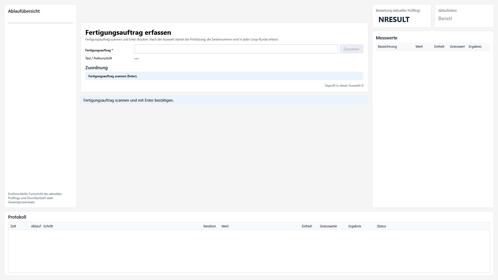

**Bild lesen:** Links steht die Ablaufübersicht. In der Mitte erscheinen die aktuelle Anweisung und das Auftragsfeld. Rechts stehen Bewertung und Messwerte. Unten liegt das Protokoll. Das Prüfprojekt kann Teile dieser Anzeige ausblenden oder anders anordnen.

### 4.1 Eine Prüfsitzung beginnen

1. Den richtigen Prüfplatz auswählen.
2. Im Feld **Fertigungsauftrag** den Auftrag scannen oder eingeben.
3. Mit Enter bestätigen beziehungsweise **Zuordnen** verwenden.
4. Die Rückmeldung prüfen. Eine eindeutige Auswahl lädt das passende Programm und startet im Auftragsmodus die Prüfsitzung.
5. Die Seriennummer des ersten Prüflings erfassen, sobald das Programm dazu auffordert.
6. Alle Anweisungen und Pflichtfelder bearbeiten.

**Erfolgskontrolle:** Das gewählte Testprogramm passt zum Auftrag. Der aktive Prüfling trägt die gerade erfasste Seriennummer. Nach Ende seiner Prüfung erscheint die nächste Seriennummernabfrage.

### 4.2 Ergebnisse verstehen

| Anzeige | Bedeutung |
| --- | --- |
| NRESULT | Noch keine bewertete Prüfung beziehungsweise unbewerteter Schritt |
| PASS | Die bewerteten Anforderungen wurden erfüllt |
| FAIL | Eine fachliche Prüfung oder Grenzwertbewertung ist nicht bestanden |
| ERROR | Ablauf-, Kommunikations-, Geräte- oder Ausführungsfehler |
| WERROR | Anzeige für Werkerabbruch während des Prüflings |

Ein Kommunikationsfehler ist nicht automatisch ein fachlich mangelhafter Prüfling. Vor Wiederholung die Fehlermeldung und die betroffene Seriennummer prüfen. Eine Endlosschleife zeigt den aktuellen Prüfling und die Durchlaufzahl statt eines vollständigen Gesamtprozentsatzes.

### 4.3 Sitzung beenden oder Auftrag wechseln

**Werkerabbruch** betätigen und den Abschluss abwarten. End-/Exit-Schritte und die Geräteabschaltung können noch laufen. Erst nach Rückkehr zu „Bereit“ denselben oder einen anderen Fertigungsauftrag scannen. Die Auswahlentscheidung wird erneut ausgeführt.

Der Werkerabbruch ist ein Softwareabbruch. Der Anlagen-Not-Halt bleibt eine separate Funktion. Keine neue Sitzung starten, solange die vorherige noch abschließt.

Bei ausgeschaltetem Auftragsmodus kann die Software stattdessen eine Kennung zuordnen und einen einzelnen Prüfling starten. Dieses alternative Verhalten ist von der aktivierten Prüfplatzkonfiguration abhängig.

## 5. Prüfprogramm im Ablaufeditor erstellen

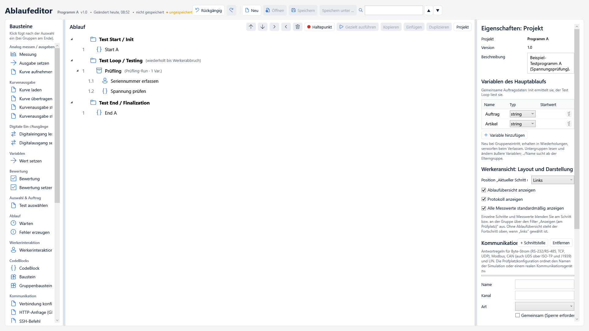

**Bild lesen:** Links befinden sich die einfügbaren Bausteine. In der Mitte steht der Ablauf. Rechts bearbeiten Sie die Eigenschaften der Auswahl. Der Knopf **Projekt** zeigt die projektweiten Einstellungen und Hauptvariablen.

### 5.1 Projekt anlegen und speichern

1. Im Ablaufeditor **Neu** verwenden oder ein bestehendes `.tproj.json` über **Öffnen** laden.
2. Name und Version in den Projekteigenschaften setzen.
3. Hauptvariablen anlegen, beispielsweise `Auftrag` und `Artikel` als String.
4. Unter einem eindeutigen Namen speichern, z. B. `programm-a.tproj.json`.

Projektdateien enthalten den Ablauf und eingebettete DLLs. **Speichern** ist keine Freigabe. Nach Änderungen ist ein erneuter Test und bei Produktivbetrieb eine neue Testprogrammfreigabe erforderlich.

### 5.2 Die drei Abschnitte aufbauen

| Abschnitt | Geeignete Aufgaben |
| --- | --- |
| Test Start / Init | Geräte vorbereiten, gemeinsame Auftragsdaten lesen, einmalige Einstellungen |
| Test Loop / Testing | Neue Seriennummer erfassen und einen Prüfling vollständig prüfen |
| Test End / Finalization | Gemeinsame Abschlussschritte und Aufräumen |

Im Loop eine Gruppe als **Prüflingslauf** konfigurieren. Diese Gruppe erhält ihre eigene lokale String-Variable `Kennung`. Am Anfang eine verpflichtende Seriennummerneingabe mit Ziel `Kennung` einfügen. Danach die eigentlichen Prüfschritte anlegen. So erhalten mehrere Geräte unter einem Auftrag getrennte Ergebnisse.

Die Seriennummer nicht dauerhaft in Start vorbelegen. Im Auftragsmodus benötigt jede Loop-Runde eine neue Erfassung. Gemeinsame Auftragsdaten gehören dagegen zu den Hauptvariablen.

### 5.3 Schritte einfügen und verschieben

1. Eine Gruppe oder einen vorhandenen Schritt in der Mitte auswählen.
2. Links einen Baustein anklicken. Bei einer Gruppe wird er am Ende eingefügt, bei einem Schritt dahinter.
3. Rechts Ressourcen, Parameter und Zielvariablen ausfüllen.
4. Mit den Pfeilen die Reihenfolge ändern beziehungsweise Schritte in Gruppen einrücken.
5. Diagnosen am Schritt und am unteren Rand prüfen.

Die Palette ist scrollbar. **CodeBlock**, **Baustein** und **Gruppenbaustein** stehen unter der Kategorie **CodeBlocks**; es gibt kein separates Menü „Bausteine hinzufügen“.

### 5.4 Variablen und Gruppen

Variablen besitzen einen Namen, Typ und Anfangswert. Namen sind groß-/kleinschreibungsabhängig: `Auftrag` und `auftrag` sind unterschiedlich. Untergruppen können äußere Variablen verwenden; `../Name` beginnt die Suche in der Elterngruppe.

Für das Bearbeiten dieser Variablen mindestens Version 1.0.4.0 verwenden. Dort werden Name, Typ und Startwert unmittelbar übernommen. Frühere Versionen konnten die Standardwerte behalten. Ungültige oder doppelte Namen und ein zum Typ unpassender Startwert werden weiterhin als Fehler angezeigt.

Eine Gruppe kann Bedingungen, Wiederholungen, Ergebnisregeln und Ressourcenreservierungen besitzen. Die Exit-Gruppe ist für Aufräumschritte vorgesehen und wird auch beim Abbruch berücksichtigt. Nicht jede wichtige Abschaltung ausschließlich in einen gewöhnlichen letzten Prüfschritt legen.

Für das Bearbeiten stehen Rückgängig/Wiederholen und Kopieren/Einfügen zur Verfügung. Textfelder behandeln ihre eigenen Textänderungen. Außerhalb der Textfelder wirken die Editorbefehle; Strg+Z/Strg+Y sowie F3 für die Suche sind in der Entwicklerkurzanleitung beschrieben.

## 6. CodeBlocks und Bibliotheksbausteine

### 6.1 Direkt im Ablauf programmieren

Ein Schritt **CodeBlock** enthält Quelltext direkt im Projektablauf. Sprache wählen und rechts den Code bearbeiten. Ein C#-Beispiel mit einer zuvor definierten numerischen Variable `Spannung`:

```csharp
return Measured(Spannung, 220.0, 240.0, "V");
```

`Measured` bewertet den Messwert gegen die Grenzen. `Pass`, `Fail`, `Error` und `NResult` dienen anderen Ergebnisarten. **Build prüfen** prüft den Code; ein erfolgreicher Build ist noch keine erfolgreich ausgeführte Geräteprüfung.

### 6.2 Einen wiederverwendbaren Baustein erstellen

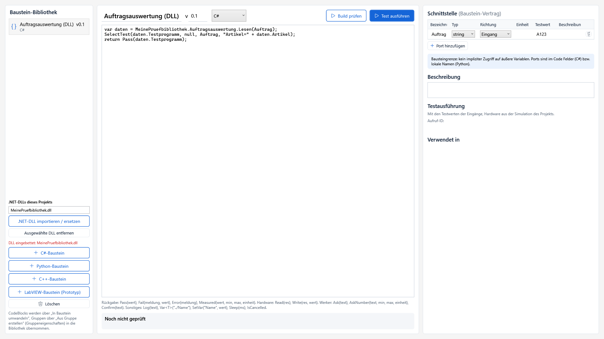

1. In der Navigation **CodeBlocks** öffnen.
2. **+ C#-Baustein** wählen und einen verständlichen Namen vergeben.
3. Nicht benötigte Beispielports entfernen.
4. Mit **Port hinzufügen** die eigene Schnittstelle definieren.
5. Quelltext bearbeiten, **Build prüfen** und **Test ausführen** verwenden.

Für die Auftragsauswertung lautet der Vertrag:

| Bezeichnung | Typ | Richtung | Testwert |
| --- | --- | --- | --- |
| Auftrag | string | Eingang | A123 |

Der Testwert wird **ohne Anführungszeichen** eingetragen. Ein Eingang wird beim Aufruf gelesen. Ein Ausgang schreibt in eine gebundene Zielvariable. Ein-/Ausgang wird gelesen und zurückgeschrieben.

Ein Bibliotheksbaustein sieht seine Ports, nicht automatisch die äußeren Prüfvariablen. Deshalb muss ein im Code verwendetes `Auftrag` im Vertrag vorhanden sein. In Versionen vor 1.0.3.0 gab es einen Fehler bei der Typübernahme der Auswahlliste; für dieses Verfahren mindestens 1.0.3.0 verwenden.

### 6.3 Den Bibliotheksbaustein im Ablauf verwenden

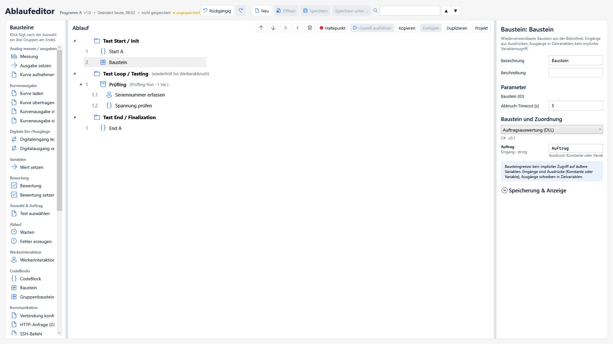

**Die beiden Stellen unterscheiden:** Links in der Palette wird ein Aufrufschritt angelegt. Rechts unter **Baustein und Zuordnung** wird festgelegt, welcher vorhandene Bibliotheksbaustein aufgerufen wird.

1. Im **Ablaufeditor** den gewünschten Abschnitt auswählen.
2. Links in der Palette zu **CodeBlocks** scrollen und **Baustein** anklicken.
3. Den eingefügten Schritt in der Mitte auswählen.
4. Rechts unter **Baustein und Zuordnung** den eigenen Baustein auswählen.
5. Beim Eingang `Auftrag` die Projektvariable `Auftrag` eintragen.
6. Ausgänge an vorhandene Zielvariablen binden und speichern.

Eine Eingangsbinding ist ein Ausdruck: `Auftrag` liest die Variable; `"A123"` wäre ein fester Stringausdruck. Das Testwertfeld der Bibliothek ist dagegen ein direktes Wertefeld. Diese beiden Eingaben nicht verwechseln.

Ein Aufruf in Start läuft einmal pro Sitzung, ein Aufruf im Prüflings-Loop pro Gerät. In End läuft er beim Abschluss. **Test ausführen** in der Bibliothek führt nur den isolierten Bausteintest mit Testwerten aus; es fügt ihn nicht automatisch in ein Prüfprogramm ein.

## 7. Eigene C#-DLL einbinden

### 7.1 DLL vorbereiten

Die DLL braucht öffentliche Klassen und Methoden, aber keine fest vorgeschriebenen Methodennamen. Der CodeBlock bestimmt die aufzurufende Methode. Das vollständige kompilierbare Bibliotheksprojekt steht im [C#-DLL-Handbuch](../handbuch-csharp-dll.md).

Beispiel einer öffentlichen Schnittstelle:

```csharp
namespace MeinePruefbibliothek;
public sealed record Auftragsdaten(string Testprogramm, string Artikel);
public static class Auftragsauswertung
{
    public static Auftragsdaten Lesen(string auftrag)
        => auftrag.Trim().ToUpperInvariant() switch
        {
            "A123" => new("Programm A", "Artikel-A"),
            "B123" => new("Programm B", "Artikel-B"),
            _ => throw new System.ArgumentException("Unbekannter Auftrag")
        };
}
```

### 7.2 Importieren und aufrufen

1. Das richtige Projekt öffnen.
2. Unter **CodeBlocks → .NET-DLL importieren / ersetzen** die kompilierte DLL wählen.
3. Zusätzlich benötigte verwaltete Abhängigkeiten ebenfalls importieren.
4. Projekt speichern und die öffentliche Methode im C#-Block aufrufen.

```csharp
var daten = MeinePruefbibliothek.Auftragsauswertung.Lesen(Auftrag);
SelectTest(daten.Testprogramm, null, Auftrag, "Artikel=" + daten.Artikel);
return Pass(daten.Testprogramm);
```

Dieses Beispiel ist für den **Auswahlablauf**. Der Namespace muss dem Inhalt der eigenen DLL entsprechen; bei deiner Bibliothek kann er beispielsweise `FA` heißen. Der DLL-Dateiname muss ihrem Assemblynamen entsprechen, nicht zwingend dem Namespace.

Eine `.cs`-Quelldatei allein genügt nicht. DLL-Bytes werden im Projekt eingebettet. NuGet-Pakete werden bei der Ausführung nicht automatisch heruntergeladen. Native Zusatzdateien und externe Konfigurationen sind keine automatisch eingebetteten .NET-DLLs.

### 7.3 DLL im normalen Testprogramm

Auch im Testprojekt importieren. Für Berechnungen oder Bewertungen eine entsprechende DLL-Methode aufrufen und das Ergebnis bewerten. Ein Ausgang `Artikel` kann beispielsweise so gesetzt werden:

```csharp
var daten = MeinePruefbibliothek.Auftragsauswertung.Lesen(Auftrag);
Artikel = daten.Artikel;
return Pass(Artikel);
```

Dafür benötigt der Bibliotheksbaustein den Eingang `Auftrag` und den String-Ausgang `Artikel`. Den Ausgang beim Aufruf an die Prüfvariable `Artikel` binden. `SelectTest` ist für die Auswahl vor dem Programm vorgesehen, nicht für den Wechsel mitten in der laufenden Prüfung.

## 8. Auftragsauswahl vor dem Prüfprogramm

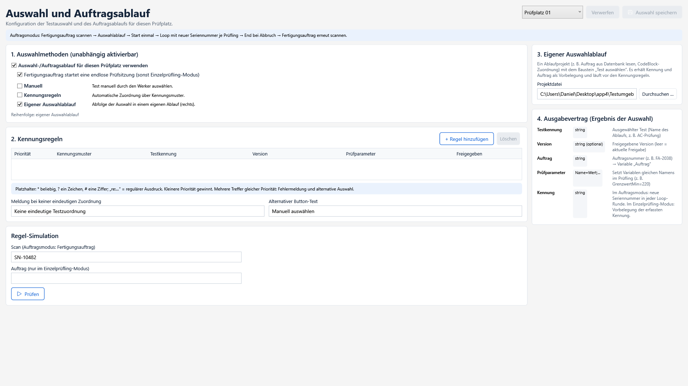

**Bild lesen:** Links werden die Methoden aktiviert. Rechts liegt die Projektdatei des eigenen Auswahlablaufs. Unten prüft die Regel-Simulation einen Beispielscan. Die Simulation dieser Seite startet kein vollständiges Testprogramm.

### 8.1 Auswahlprojekt erstellen

1. Ein separates Projekt anlegen und als `auswahl-dll.tproj.json` speichern.
2. Hauptvariable `Auftrag` vom Typ String anlegen.
3. DLL und Baustein aus Abschnitt 7 in dieses Projekt aufnehmen.
4. In Start/Init einen **Baustein**-Schritt einfügen, den Auswahlbaustein wählen und `Auftrag` binden.
5. Sicherstellen, dass der Code `SelectTest(...)` aufruft. Ein bloßes `Pass("Programm A")` wählt kein Programm.
6. Speichern und mit A123 testen.

### 8.2 Prüfplatz konfigurieren

1. **Auswahl & Auftrag** öffnen und den richtigen Prüfplatz wählen.
2. **Auswahl-/Auftragsablauf für diesen Prüfplatz verwenden** aktivieren.
3. **Fertigungsauftrag startet eine endlose Prüfsitzung** aktivieren.
4. **Eigener Auswahlablauf** aktivieren und rechts die gespeicherte Auswahlprojektdatei wählen.
5. Für eine reine DLL-Entscheidung manuelle Auswahl und Kennungsregeln deaktivieren.
6. **Auswahl speichern** verwenden. Die Konfiguration muss für den Prüfplatz schreibbar sein.
7. In der Regel-Simulation `A123` eintragen und **Prüfen** betätigen.

**Erfolgskontrolle:** Die Zuordnung liefert Programm A. Ein unbekannter Auftrag wird abgelehnt. Erst danach den Ablauf im Beispielbetrieb beziehungsweise mit einer freigegebenen Produktivversion vollständig prüfen.

### 8.3 Auftrag und Artikel ins Zielprogramm übernehmen

Im Zielprojekt die Hauptvariablen `Auftrag` und `Artikel` als String anlegen. `SelectTest` gibt den Auftrag und die Vorbelegung `Artikel=...` weiter. Der Artikelwert darf im einfachen Parameterformat keine ungeeigneten Trennzeichen enthalten. Die Seriennummer wird im Zielprogramm je Prüfling frisch erfasst.

Auswahlprojekt und Testprojekt haben getrennte DLL-Importe. Ein Import im Auswahlprojekt allein stellt die DLL nicht dem ausgewählten Testprogramm zur Verfügung.

## 9. Prüfplätze und Geräte einrichten

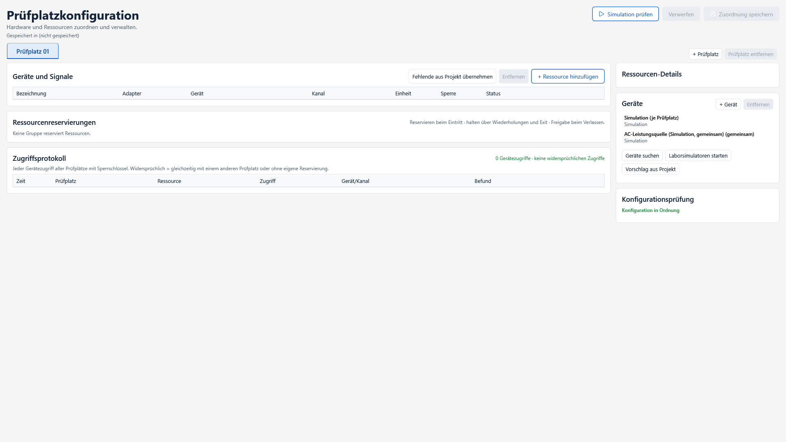

Ein Prüfprogramm verwendet abstrakte Ressourcennamen. Die Prüfplatzkonfiguration legt fest, welches reale oder simulierte Gerät und welcher Kanal dahinterstehen.

1. **Prüfplatzkonfiguration** öffnen und Prüfplatz auswählen.
2. Rechts über **+ Gerät** das Gerät anlegen und Adapter, Adresse, Optionen und Zeitlimit ausfüllen.
3. Über **+ Ressource hinzufügen** den vom Programm verwendeten Namen anlegen.
4. Ressource an das passende Gerät und den Kanal binden.
5. Konfigurationsmeldungen prüfen und mit **Zuordnung speichern** sichern.
6. Zuerst Simulation beziehungsweise Gerätetest und anschließend die tatsächliche Gerätefunktion prüfen.

Beispiel: Das Programm verwendet `Pruefling_Seriell`. Das Gerät hat Adapter „Seriell (RS-232/RS-485)“, Adresse COM3 und Baud 115200. Die Ressourcenzeile verbindet diesen Namen mit dem seriellen Gerät.

**Gemeinsame Geräte:** Wenn mehrere Prüfplätze ein Gerät verwenden, gemeinsame Sperrschlüssel und Ressourcenreservierungen passend konfigurieren. Eine Gruppe hält die Reservierung über die zusammengehörige Transaktion. Das Zugriffsprotokoll zeigt Konflikte. Eine erfolgreiche Simulation ersetzt keine Prüfung der realen Verkabelung und Geräteoptionen.

Die unterstützten Adapter und deren genaue Optionen sind in [Geräte](../geraete.md) beschrieben.

## 10. COM und Netzwerkkommunikation

### 10.1 COM-Port während der Prüfung ändern

1. String-Variable `ComPort` mit Anfangswert `COM3` anlegen.
2. Im Schritt **Senden**, **Empfangen** oder **Abfrage** die serielle Ressource wählen.
3. Bei **Adresse / COM-Port** `{ComPort}` eintragen.
4. `ComPort` später per „Wert setzen“, Eingabe oder C# ändern.

```csharp
ComPort = "COM7";
return Pass(ComPort);
```

Beim nächsten Kommunikationsschritt wird der aktuelle Wert ausgewertet. Ein Zielwechsel schließt die alte Verbindung. Alternativ ändert **Verbindung konfigurieren** ausdrücklich die Adresse für nachfolgende Schritte. Leeres Adressfeld verwendet die aktuelle Geräteadresse.

Verbindungsoptionen sind mehrere Zeilen `Schlüssel=Wert`, beispielsweise `Baud=115200`. Nichtleere Optionen ersetzen den vollständigen Optionssatz; leere Optionen behalten den bestehenden Satz. Optionen benötigen eine Adresse. `{Variable}` kann auch innerhalb von Optionswerten eingesetzt werden.

### 10.2 SSH-Befehle

Gerät **SSH / SFTP** anlegen, Adresse beispielsweise `192.168.1.20:22`. In den Optionen Benutzer, Passwort oder Schlüsseldatei sowie `HostKeySHA256` setzen. Den echten SHA256-Fingerabdruck der Gegenstelle verwenden; falscher oder fehlender Fingerabdruck verhindert die Verbindung.

Im Ablauf **SSH-Befehl** einfügen. Befehl, Zeitlimit und optional Antwort-, Status- und Fehlerzielvariablen setzen. Standardmäßig ist Exitcode 0 PASS. Jeder Schritt öffnet eine eigene SSH-Verbindung: ein `cd` in einem Schritt beeinflusst nicht den nächsten.

### 10.3 SFTP-Dateien

**SFTP-Datei hochladen** beziehungsweise **herunterladen** verwenden. Lokale Datei, Remote-Datei, Zeitlimit und Überschreibentscheidung setzen. Pfade können Variablen enthalten. Der lokale Zielordner für Downloads muss existieren. Downloads werden erst nach vollständigem Empfang übernommen; Uploads können bei Abbruch eine unvollständige Remote-Datei hinterlassen.

### 10.4 HTTP GET, POST und weitere Methoden

Gerät **HTTP / HTTPS** mit Basisadresse anlegen. Im Schritt **HTTP-Anfrage (GET / POST / …)** Ressource, Methode, Pfad, Header, Body und Antwort-/Statusziele setzen. Beispiel:

```text
Methode: POST
Pfad: /api/test
Header: Content-Type: application/json
Body: {{"seriennummer":"{Kennung}"}}
```

Die doppelten Klammern erzeugen literale JSON-Klammern, `{Kennung}` setzt die Variable ein. Für beliebige Stringinhalte JSON mit einem Serializer erzeugen, statt Werte ungeprüft in JSON zu schreiben.

Standardbewertung: HTTP 200–299 ist PASS. Andere Erwartungen lassen sich festlegen. Die Antwort ist auf 1 MiB begrenzt. HTTPS prüft Zertifikate normal; Redirects werden nicht automatisch verfolgt. Diese Funktionen benötigen kein installiertes curl, bilden aber nicht sämtliche curl-Sonderoptionen ab.

### 10.5 TCP und Telnet

Für reine TCP-Protokolle den TCP-Client verwenden, für Telnet den Telnet-Adapter. Adresse `Host:Port`, danach Senden und Empfangen nutzen. Bei interaktiven Login-Dialogen erst den Prompt empfangen, dann die Antwort senden. „Abfrage“ verwirft vorherige Eingabedaten und ist deshalb nicht für jeden Promptdialog geeignet. Telnet-Verhandlung wird behandelt; eine vollständige Terminalemulation ist nicht enthalten.

Alle neuen Protokolle sind direkt in der Software verfügbar. Die [Kommunikationsanleitung](../dynamische-verbindungen.md) enthält sämtliche Parameter und die C#-/Python-Hilfsfunktionen.

## 11. Simulation und Debugger

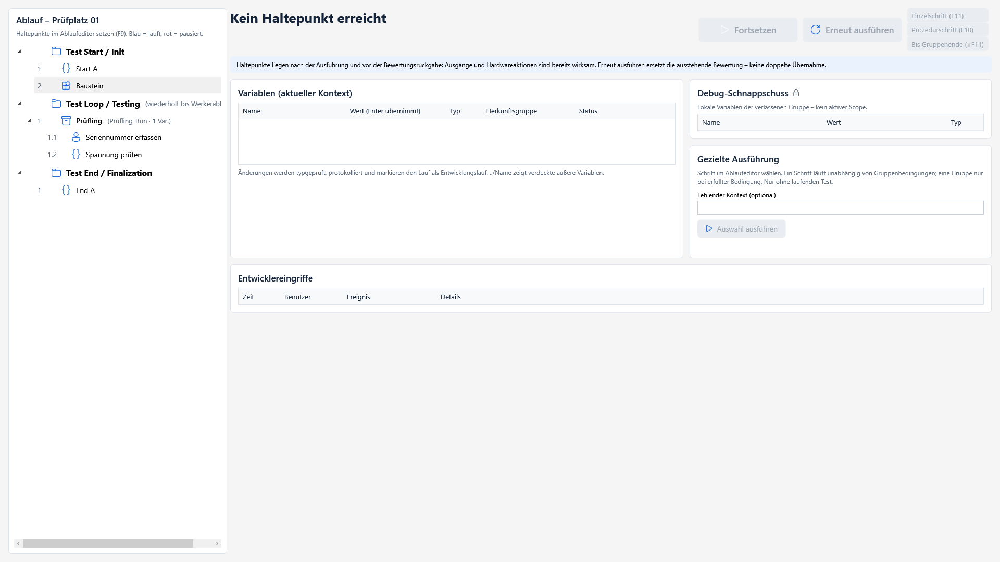

1. Das richtige Projekt und den richtigen Prüfplatz wählen.
2. Den Entwurf für die Simulation verwenden. Eine Simulation auf echten Geräten nicht mit einer Produktionsfreigabe gleichsetzen.
3. Haltepunkte im Ablaufeditor setzen, z. B. vor einer Bewertung.
4. **Simulation starten** und die Seite **Debug** öffnen.
5. Beim Haltepunkt Variablen und Position prüfen; danach fortsetzen oder schrittweise ausführen.

**Einzelschritt**, **Prozedurschritt** und **Bis Gruppenende** dienen der gezielten Ablaufprüfung. Einzelschritt/Prozedurschritt verwenden F11/F10; Haltepunkte lassen sich im Editor mit F9 setzen. Bei CodeBlocks können je nach Sprache Zeilen und Variablen untersucht werden. Fremde DLLs erhalten durch ihren Import kein internes Zeilen-Stepping.

Ablauf-Haltepunkte liegen nach der Schrittausführung und vor der Bewertungsrückgabe. Geräteausgänge können zu diesem Zeitpunkt bereits wirksam sein. Ein Halt ist daher kein Schutz davor, dass der ausgewählte Schritt ein Gerät ansteuert. Quellcode-Haltepunkte innerhalb eines CodeBlocks sind davon zu unterscheiden.

**Build prüfen**, **isolierter Bausteintest**, **Ablaufsimulation** und **Hardwareabnahme** sind verschiedene Prüfungen. Vor Freigabe alle für das Programm relevanten Ebenen durchführen. Abbruch und ungültige Eingaben ausdrücklich mitprüfen.

## 12. Testprogramme freigeben

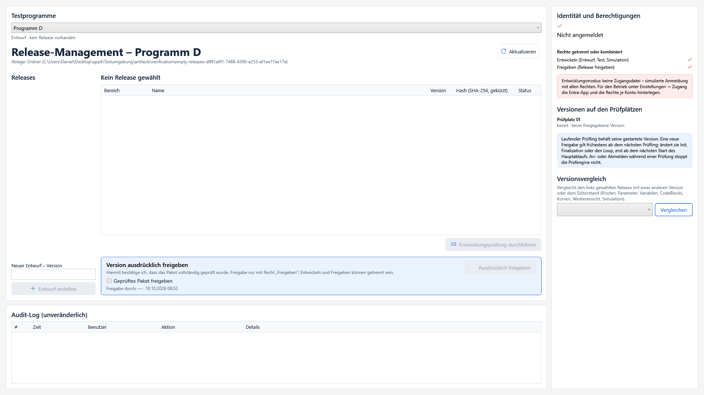

Die Seite **Releases** zeigt die Programme und deren Versionsstände. Die Werkeransicht benötigt keine Liste aller freigegebenen Programme; sie verwendet die Auftragsauswahl.

1. Oben das gewünschte Testprogramm wählen, z. B. Programm A.
2. Das zugehörige Projekt speichern und eine neue Version festlegen.
3. **Entwurf erstellen** verwenden.
4. Den Entwurf wählen und **Entwicklungsprüfung durchführen**.
5. Prüfergebnisse und Diagnosen kontrollieren; notwendige funktionale Abnahme durchführen.
6. Mit dem Recht „Freigeben“ die ausdrückliche Bestätigung **Geprüftes Paket freigeben** setzen und **Ausdrücklich freigeben** verwenden.

Eine sichtbare Programmzeile ist noch keine Freigabe. „Entwurf · kein Release vorhanden“ erklärt, warum dieses Programm im Produktivbetrieb noch nicht ausgewählt werden kann. Je Programm müssen passende freigegebene Versionen vorliegen.

DLL- und Ablaufänderungen gehören in einen neuen geprüften Stand. Eine laufende Sitzung übernimmt nicht einfach eine geänderte DLL zwischen zwei Prüflingen.

### 12.1 Software selbst als MSIX veröffentlichen

`Release-MSIX.cmd` im Quellprojekt starten und eine neue vierteilige Version eingeben. Das Skript baut, testet, paketiert und signiert die **Software**. Das Ergebnis liegt unter `artifacts/msix/<Version>/`. Bereits vorhandene Bundleversionen werden nicht überschrieben. Einzelheiten und Signierzertifikate: [MSIX-Release](../msix-release.md).

Die Programmversion in „Releases“ und die MSIX-Softwareversion haben unterschiedliche Aufgaben. Ein MSIX-Build gibt kein Prüfprogramm automatisch frei.

## 13. Ergebnisse und Berichte

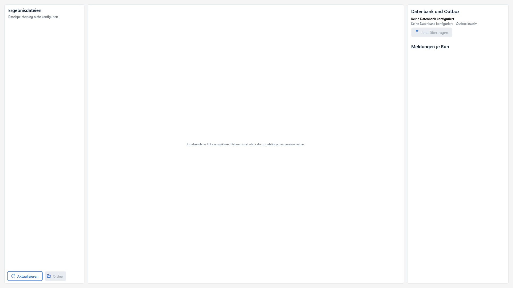

1. **Ergebnisse** öffnen und den richtigen Ergebnisordner wählen.
2. Aktualisieren und eine Datei auswählen.
3. Fertigungsauftrag, Seriennummer, Prüfplatz, Zeit und Bewertung kontrollieren.
4. Schritte, Messwerte und vorhandene Kurven prüfen.

Im Auftragsmodus muss jeder fertige Prüfling seiner eigenen Seriennummer zugeordnet sein. Ein Abbruch während einer noch unbeantworteten Seriennummernabfrage kann einen abgebrochenen Datensatz ohne Kennung erzeugen. Er gehört nicht automatisch zur zuvor geprüften Seriennummer.

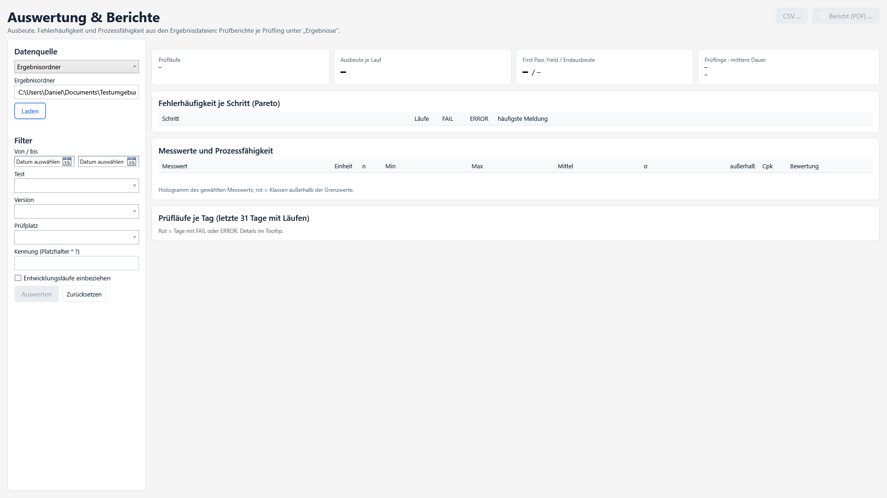

Unter **Auswertung** Datenquelle und Filter wählen, dann **Laden**. Zeitraum, Programm und Prüfplatz begrenzen die ausgewerteten Ergebnisse. CSV und PDF-Berichte sind über die zugehörigen Schaltflächen verfügbar. Eine leere Ansicht bedeutet, dass noch keine passenden Daten geladen wurden.

Kennzahlen wie Ausbeute und Prozessfähigkeit hängen von der Datenbasis ab. Vor einem Vergleich Filter, Messwertauswahl, Einheiten und Grenzen kontrollieren. Fehlende oder ungeeignete Daten nicht als belastbare Prozessbewertung behandeln.

## 14. Kurven verwenden

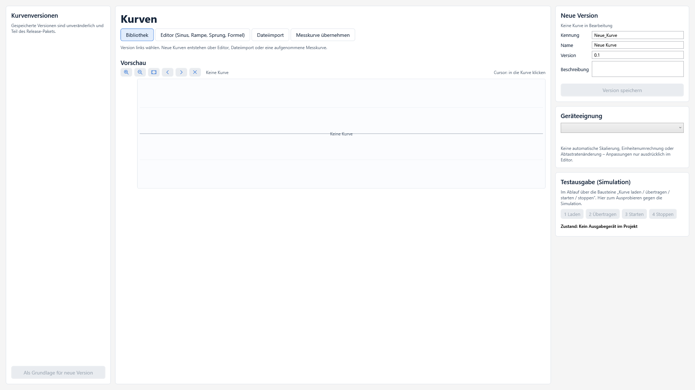

Die Seite **Kurven** dient dem Import und der Untersuchung von Kurvendaten. Im Ablauf können Kurven geladen, ausgegeben oder aufgenommen werden.

1. Kurvendatei auswählen beziehungsweise importieren.
2. Achsen, Einheit, Wertebereich und Vorschau kontrollieren.
3. Die gewünschte Kurve im passenden Ablaufbaustein verwenden.
4. Gerätezuordnung und Ausgabeparameter prüfen.
5. Anzeige und Speicherung der Kurven im Projekt bewusst einstellen.

Eine Vorschau ist noch keine tatsächliche Kurvenausgabe am Gerät. Vor Hardwarebetrieb Wertebereich und sichere Ausgangszustände prüfen.

## 15. Einstellungen, Sicherung und Betrieb

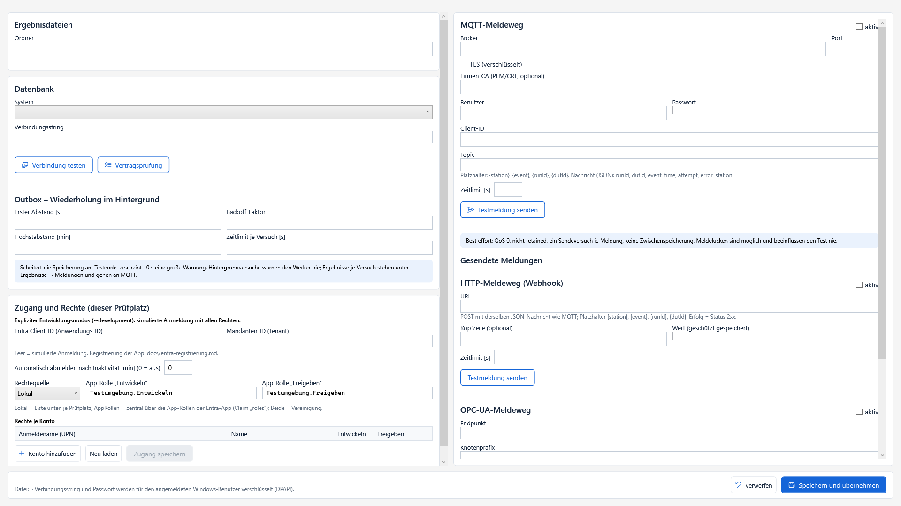

In **Einstellungen** den Ergebnisordner, Datenbank und benötigte Meldewege konfigurieren. Einstellungen können je Windows-Benutzer getrennt sein; beim Wechsel des Benutzerkontos daher Ablage und Releases kontrollieren.

1. Einen vorhandenen, beschreibbaren Ergebnisordner festlegen.
2. Falls verwendet, Datenbankanbieter und Verbindung einstellen.
3. Verbindungstest und Vertragsprüfung durchführen.
4. Outbox und gewünschte Meldungen konfigurieren.
5. Einstellungen speichern und eine Beispielprüfung bis zur Ergebnisablage durchführen.

Bei einem Datenbankausfall können Ergebnisse lokal in der Outbox verbleiben und später übertragen werden. Ein nicht erreichbarer Ergebnisordner kann zur Ablage im Wiederherstellungsordner führen. Solche Meldungen prüfen statt nur weiterzuklicken.

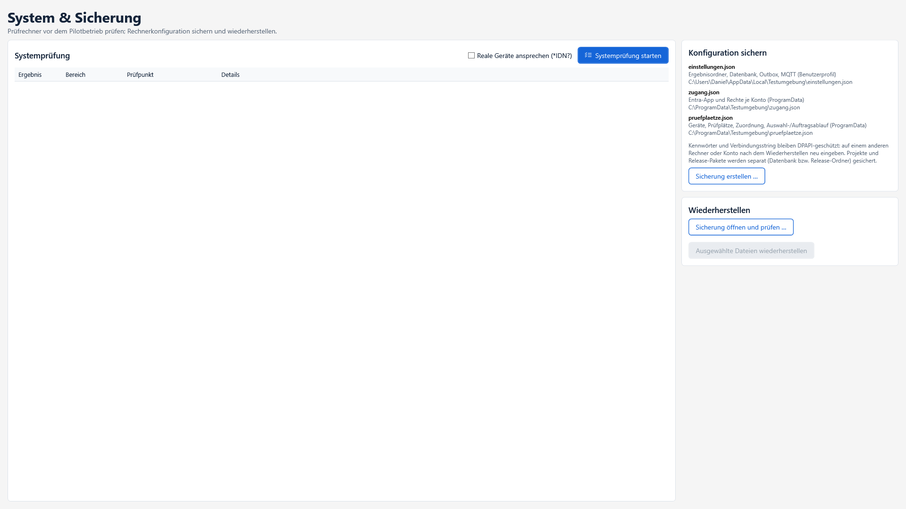

### 15.1 Systemprüfung und Sicherung

**System & Sicherung** öffnen. Vor produktiver Inbetriebnahme die Systemprüfung ausführen; reale Geräte nur bewusst ansprechen. Fehler beheben, danach **Sicherung erstellen** und die Sicherung außerhalb des Prüfrechners aufbewahren.

Die Konfigurationssicherung ersetzt keine Sicherung der eigenen Projektdateien, Release-Pakete und Ergebnisse. Diese Ablagen zusätzlich sichern.

Bei Wiederherstellung die enthaltenen Konfigurationen und deren Ziel prüfen. Maschinen- oder benutzergebundene Geheimnisse können auf einem anderen Rechner neu eingegeben werden müssen. Anschließend Systemprüfung und funktionale Prüfung durchführen.

### 15.2 Wichtige Ablageorte

| Ort | Inhalt |
| --- | --- |
| `%ProgramData%/Testumgebung/pruefplaetze.json` | Prüfplätze, Gerätezuordnung und Auswahlkonfiguration |
| `%ProgramData%/Testumgebung/zugang.json` | Produktionszugang und Rechtekonfiguration |
| `%LOCALAPPDATA%/Testumgebung/einstellungen.json` | Benutzerbezogene Einstellungen |
| `%LOCALAPPDATA%/Testumgebung/Releases` | Lokale Releaseablage, sofern keine andere Ablage verwendet wird |
| `%LOCALAPPDATA%/Testumgebung/Outbox` | Noch zu übertragende Ergebnisse |
| `%LOCALAPPDATA%/Testumgebung/Zwischenaufzeichnung` | Wiederherstellungsjournale unvollständiger Prüfläufe |
| `%LOCALAPPDATA%/Testumgebung/Wiederherstellung` | Ersatzablage bei Problemen mit dem Ergebnisordner |

### 15.3 Nach Absturz oder Stromausfall

Unter **Ergebnisse → Unvollständige Prüfläufe** betroffene Journale prüfen. **Als abgebrochen speichern** zeichnet den Abbruch auf; **Verwerfen** verwirft das Journal nachvollziehbar. Es erfolgt keine automatische Fortsetzung mitten in einer Prüfung. Den Prüfling nach Klärung erneut prüfen.

## 16. Ein vollständiges Beispiel von A123 bis zum Ergebnis

Diese Reihenfolge eignet sich als erste eigene Einrichtung:

1. Version 1.0.3.0 installieren und den Beispielbetrieb kennenlernen.
2. `MeinePruefbibliothek.dll` nach dem DLL-Handbuch bauen. A123 muss Programm A liefern.
3. Auswahlprojekt `auswahl-dll.tproj.json` erstellen: Hauptvariable Auftrag, DLL-Import, Bibliotheksbaustein mit String-Eingang Auftrag und dem `SelectTest`-Code.
4. In Start/Init den Bibliotheksbaustein aufrufen und Eingang Auftrag an Projektvariable Auftrag binden.
5. Testprojekt Programm A erstellen: Hauptvariablen Auftrag/Artikel, Start, Loop und End.
6. Im Loop eine Prüflingsgruppe mit lokaler String-Variable Kennung anlegen. Als ersten Schritt die verpflichtende Seriennummernabfrage hinzufügen.
7. Für den ersten Test eine simulierte Spannungsprüfung aufbauen, z. B. numerische Prüfvariable Spannung mit 230 und Bewertung 220–240 V. Danach echte Messung und Gerätezuordnung einrichten.
8. Beide Projekte speichern und Auswahlprojekt unter Auswahl & Auftrag hinterlegen. Auftragsmodus aktivieren.
9. Auswahl mit A123 simulieren. Programm A muss zugeordnet werden.
10. A123 in der Werkeransicht scannen. Erste Seriennummer SN-001 eingeben, Ergebnis kontrollieren; anschließend SN-002 prüfen.
11. Werkerabbruch verwenden und Abschluss abwarten. Danach B123 scannen, sofern Programm B entsprechend eingerichtet ist.
12. Ergebnisablage kontrollieren: SN-001 und SN-002 müssen getrennte Prüflinge mit Auftrag A123 sein.
13. Unbekannten Auftrag, Fehler bei der Datenquelle, Grenzwertverletzung und Abbruch testen.
14. Die Ziel-Testprogramme produktiv prüfen und freigeben. Erst danach ohne Entwurfs-/Beispielbetrieb verwenden.

## 17. Fehler finden und beheben

| Beobachtung | Ursache prüfen / nächster Schritt |
| --- | --- |
| Auftrag im aktuellen Kontext unbekannt | Bibliotheksport exakt Auftrag vorhanden? String-Typ tatsächlich übernommen? Aufruf an Projektvariable gebunden? |
| Wert muss Zahl sein trotz angezeigtem string | Update mindestens 1.0.3.0 installieren, Typ erneut setzen und mit A123 testen |
| Schnittstelle ungültig | Alle Ports auf gültige, eindeutige Namen und passende Testwerte prüfen |
| Unbekannter Fertigungsauftrag aus der DLL | Auftrag entspricht keiner DLL-Regel; A123 verwenden oder Regeln erweitern |
| DLL-Namespace nicht gefunden | Richtige kompilierte DLL im aktuellen Projekt importiert? Namespace und public-Typen korrekt? |
| Keine eindeutige Testzuordnung | Auswahlprojekt, Scan und verfügbare Programmkennung prüfen |
| Keine freigegebene Version | Passendes Programm unter Releases wählen, prüfen und ausdrücklich freigeben |
| Baustein fehlt in der Palette | Im Ablaufeditor links scrollen; Kategorie CodeBlocks → Baustein. Bibliotheksseite erstellt den Baustein, fügt ihn nicht in den Ablauf ein |
| Kein Bibliotheksbaustein gewählt | Den Aufrufschritt auswählen und rechts Baustein und Zuordnung ausfüllen |
| Seriennummer wird nicht erneut abgefragt | Eigene lokale Kennung und Pflicht-Eingabe am Anfang der Prüflingsgruppe im Loop prüfen |
| COM-Ziel ändert sich nicht | Adresse als `{ComPort}` gesetzt? Variable im verfügbaren Bereich? Unterstützter Byte-Strom-Adapter? |
| SSH wird abgelehnt | Host, Port, Benutzer, Authentifizierung und echten HostKeySHA256 prüfen |
| SFTP überschreibt nicht | Überschreiboption ausdrücklich setzen; lokalen Zielordner und Remote-Pfad prüfen |
| HTTP-Schritt FAIL | Statusziel ansehen; erwarteten Bereich und fachliche Serverantwort prüfen |
| Wartet auf Ressource | Andere Prüfung hält das Gerät; Reservierung und Zugriffsprotokoll prüfen |
| Neue DLL wird nicht verwendet | DLL erneut importieren, Projekt speichern, neue Freigabe laden und Sitzung neu starten |
| Prüfung startet nicht | Auftragszuordnung, Freigabe, Prüfplatzkonfiguration und aktive Abschlussphase prüfen |

Für eine Fehleranalyse festhalten: Softwareversion, Prüfplatz, Projekt und Releaseversion, vollständige Meldung, Schrittname, verwendeter Scan und ob Simulation oder reale Hardware betroffen ist. Passwörter und Zugriffstoken nicht in Screenshots oder Fehlertexte aufnehmen.

## 18. Weiterführende Anleitungen und Bilddateien

- [C#-DLL-Handbuch mit vollständigem Bibliotheksprojekt](../handbuch-csharp-dll.md)
- [Dynamische Verbindungen: sämtliche Optionen und Codefunktionen](../dynamische-verbindungen.md)
- [Fertigungsauftrag und Beispiele](../beispiele/README-auftragsauswahl.md)
- [Geräte und Treiber](../geraete.md)
- [MSIX erstellen und installieren](../msix-release.md)
- [Zugang mit Entra konfigurieren](../entra-registrierung.md)
- [Entwicklerkurzanleitung](entwickler.md)
- [Administrator-Kurzanleitung](administrator.md)
- [Pilot-Abnahmeprotokoll](../pilot/abnahmeprotokoll.md)

Das Handbuch benötigt den zugehörigen Ordner **bilder**. Beim Weitergeben die Markdown-Datei und diesen Ordner zusammen kopieren. Relative Bild- und Dokumentlinks sind für die Projektablage ausgelegt; die vollständige Dokumentation wird am einfachsten als gemeinsamer docs-Ordner verteilt.

