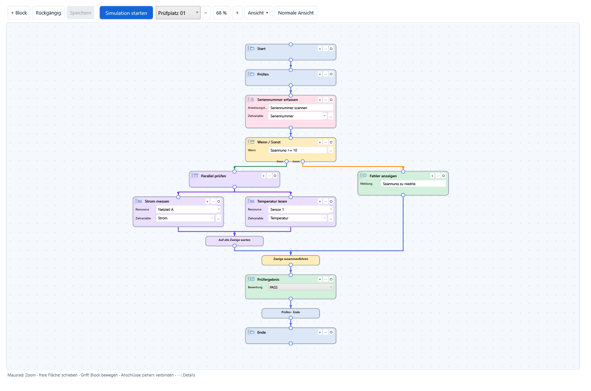
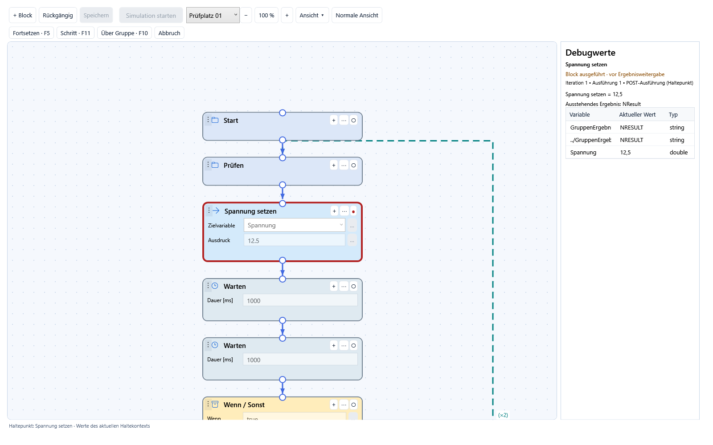

# Knotenansicht: Verbinden, Zoomen und Debuggen

Ab Version 1.2.0 im Ablaufeditor **Knotenansicht** einschalten. Das Prüfprogramm
wird als verbundener Graph dargestellt. Die kompakte Darstellung zeigt pro Block
nur die wichtigsten Eingaben, beispielsweise Gerät und Zielvariable. Weitere
Einstellungen bleiben in der normalen Ansicht verfügbar.

## Einfach bearbeiten, Details bei Bedarf öffnen

- Den Namen direkt im Kopf des Blocks ändern. **+ Block** fügt am ausgewählten
  Block ein; das kleine **+** im Kopf fügt direkt an diesem Block hinzu.
- Wichtige Werte, Geräte und Zielvariablen direkt im Block eingeben oder auswählen.
- Der kleine **…**-Knopf neben einem Ausdruck öffnet den Bedingungs-/Ausdruckseditor.
  Bei Wenn/Sonst wird die eigentliche Entscheidung bearbeitet, mit den Variablen
  ihres gültigen Kontexts. **Übernehmen** und **Rückgängig** funktionieren wie bisher.
- **⋯** im Blockkopf oder **Normale Ansicht** öffnet alle Eigenschaften am
  ausgewählten Block. Dort stehen unter anderem Ressourcen, Wiederholungsregeln,
  Kommentare, Haltebedingungen, Code und Bibliotheksanschlüsse zur Verfügung.
- Rechtsklick auf eine freie Stelle des Blocks öffnet Aktionen wie Duplizieren,
  Verschieben, Aktivieren/Deaktivieren und Löschen.

Dann und Sonst sowie parallele Zweige stehen nebeneinander. Leere Zweige bleiben
als Einfügeplatz sichtbar; gefüllte Zweige beginnen direkt mit ihrem ersten Block.
Nach parallelen Zweigen zeigt ein gemeinsamer Knoten das Warten auf alle Zweige.
Zusammenführungen liegen unter dem längsten Zweig. Das vereinfacht die Darstellung,
ohne die Gruppen, Variablenbereiche oder Ausführungsregeln des Programms zu verändern.

## Arbeitsfläche bewegen

- **Mausrad** vergrößert oder verkleinert um den Mauszeiger. Über Textfeldern und
  Auswahllisten dient das Rad dem jeweiligen Eingabefeld; **Strg + Mausrad** zoomt dort.
- Eine freie Fläche mit links ziehen oder die **mittlere Maustaste** halten,
  um die Ansicht nach oben, unten, links oder rechts zu schieben.
- **+**, **−** und **100 %** steuern den Zoom auch ohne Mausrad.
- **Ansicht → Alles anzeigen** zeigt den gesamten Ablauf als Übersicht.
- Am kleinen Griff **⋮** einen Knoten frei platzieren.
  Seine Position verändert die Ausführungsreihenfolge nicht.
- **Ansicht → Automatisch anordnen** stellt eine übersichtliche Anordnung wieder her.

Knotenpositionen und Zoom sind Zustand der geöffneten Ansicht. Speichern und
Rückgängig setzen den Bildausschnitt nicht zurück. Die Projektdatei
speichert weiterhin die ausführbare Ablaufstruktur, nicht Bildschirmkoordinaten.

## Anschlüsse manuell verbinden

Den kleinen **Ausgangskreis** eines Blocks auf den **Eingangskreis** eines anderen
Blocks ziehen. Der vollständige Zielblock einschließlich seiner Untergruppen
wird an die neue Position im Ablauf verschoben. Seine bisherige Verbindung
wird entsprechend ersetzt. **Rückgängig** nimmt diese Änderung zurück.

| Ausgang | Bedeutung beim Verbinden |
| --- | --- |
| Weiter an einem Schritt | Ziel unmittelbar nach diesem Schritt ausführen |
| In Gruppe | Ziel als ersten Schritt dieser Gruppe einsetzen |
| Dann / Sonst | Ziel in den entsprechenden Zweig der Wenn/Sonst-Gruppe einsetzen |
| Parallelzweig | Ziel als weiteren gleichzeitigen Zweig in die Parallelgruppe aufnehmen |
| Weiter am Gruppenende | Ziel nach Abschluss dieser Gruppe ausführen |

Neue Blöcke über **+** an einem bestehenden Block hinzufügen. Eine
Wenn/Sonst-Vorlage hat getrennte Ausgänge. Parallele Gruppen starten ihre
Kinder gemeinsam; ein eigener Knoten stellt das Warten auf alle Zweige dar.
Wiederholungen sind als Rücklinie gekennzeichnet. Exit-Gruppen werden als
Aufräumpfad dargestellt. Bibliothekskörper stehen als getrennte, mit
**Definition** beschriftete Graphen neben dem Hauptablauf; sie werden über den
entsprechenden Baustein aufgerufen.

Die Verbindung bearbeitet den bestehenden strukturierten Ablauf. Feste
Start-/Loop-/End-Abschnitte, technische Wenn/Sonst-Bestandteile und der Abschluss
paralleler Zweige bleiben geschützt. Zyklen und ungültige Einfügepositionen
werden abgewiesen. Wiederholungen werden über die Wiederholungseinstellung
der Gruppe definiert. Nach einem Wechsel des Gültigkeitsbereichs die
Variablenbindungen und die Simulation prüfen.

## Im Graphen debuggen

Haltepunkte über den **○ / ●**-Knopf am oberen Rand des gewünschten Knotens
setzen. Alternativ den Knoten auswählen und außerhalb von Eingabefeldern **F9**
drücken. Danach **Simulation starten** wählen.
Der bisherige Haltezeitpunkt bleibt erhalten:

1. Der Block ist bereits ausgeführt; seine Ausgänge und Variablenänderungen sind wirksam.
2. Das Ergebnis wurde noch nicht an die umgebende Gruppe weitergegeben.
3. Der aktive Knoten wird markiert und in den sichtbaren Bereich gebracht.
4. Rechts erscheinen die Variablen und ihre aktuellen Werte dieses Haltekontexts.

Beispiel: Ein Block setzt `Spannung` von 0 auf 12,5. Sein Haltepunkt zeigt rechts
**12,5**, während das Ergebnis noch aussteht. Es handelt sich um einen am
Haltepunkt erfassten Zustand, nicht um eine fortlaufend aktualisierte Liveanzeige
während der Blockausführung. Die Tabelle in der Knotenansicht ist schreibgeschützt.

**Fortsetzen / F5**, **Schritt / F11** und **Über Gruppe / F10** nutzen denselben
Debugger wie die klassische Ansicht. Der Prüfplatz wird oben ausgewählt.
Code-Haltepunkte zeigen zusätzlich die vom Worker erfassten lokalen Variablen.
Bei Gruppen wird der verlassene lokale Kontext als Schnappschuss angezeigt.

Während eines laufenden Tests sind Umverdrahtung und Parameterbearbeitung in der
Knotenansicht gesperrt. Zoom und Verschieben bleiben möglich. Änderungen an den
Debugvariablen und Run-Patches stehen weiterhin im vollständigen Debugger zur
Verfügung. Die Knotenansicht verändert weder Haltebedingungen noch die
Auswertungs- und Abbruchregeln der Prüfengine.
