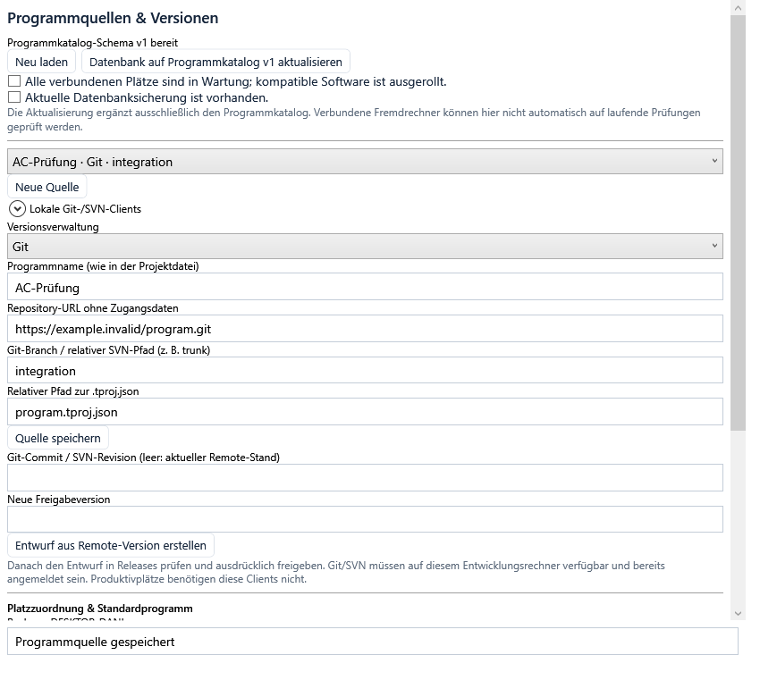
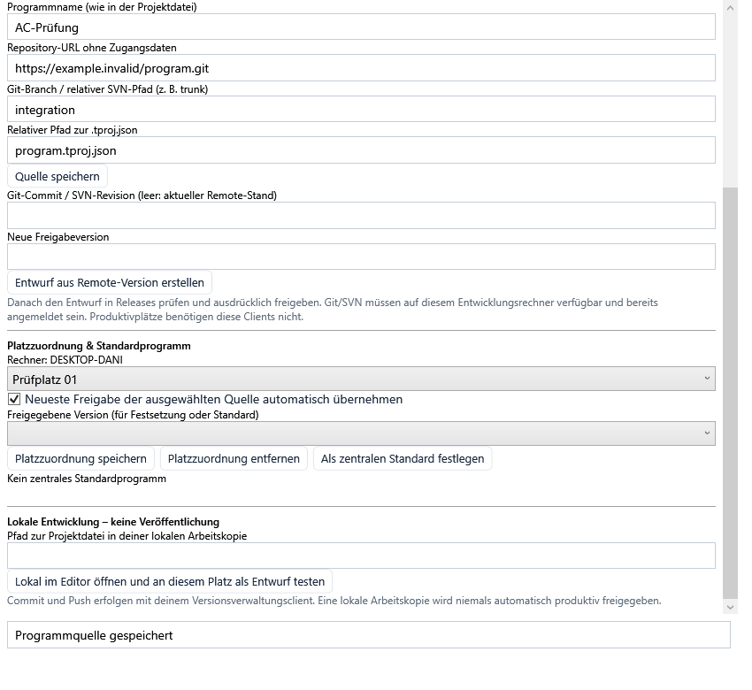

# Versionierte Prüfprogramme mit Git und SVN

## Einrichtung und Datenbank-Upgrade

Unter **Releases → Programmquellen & Versionen …** öffnet sich ein eigenes Fenster innerhalb der Testumgebung. Das Fenster ist für Entwickler und Freigabeberechtigte verfügbar. Werker können Zuordnungen nicht ändern.

Die Funktion verwendet einen **separat versionierten Programmkatalog (Schema v1)**. Das vorhandene Ergebnisschema v3 und vorhandene Releases werden nicht umgebaut. Bei SQL-Datenbanken wird die zusätzliche Tabelle `tu_program_catalog` mit einer Versionszeile, einem Änderungszähler und den zentralen Einstellungen angelegt. Ohne SQL-Verbindung wird ein entsprechender Katalog neben der Release-Ordnerablage geführt.

1. Die Datenbank mit dem üblichen Werkzeug des Datenbankbetreibers sichern (SQL Server Backup, PostgreSQL pg_dump, MySQL-Dump oder SQLite-Sicherung bei ruhenden Schreibern). Die Konfigurationssicherung der Testumgebung ersetzt keine Datenbanksicherung.
2. Alle verbundenen Plätze in Wartung nehmen und eine kompatible Softwareversion ausrollen. Dieses Fenster kennt die lokal laufenden Prüfungen; es kann fremde Rechner oder ältere Clients nicht zuverlässig auf laufende Prüfungen prüfen. Die Bestätigung gilt deshalb ausdrücklich für die gesamte Installation.
3. Beide Bestätigungen für Wartung und Sicherung setzen.
4. **Datenbank auf Programmkatalog v1 aktualisieren** betätigen. Dafür ist das Recht Freigeben erforderlich. Lokale laufende Prüfungen verhindern die Aktualisierung zusätzlich.

Die Migration ergänzt ausschließlich den Katalog. Sie verändert keine Prüfergebnisse oder Paketbytes. Ein erneuter Aufruf ist möglich; konkurrierende Katalogänderungen werden anhand des Änderungszählers abgewiesen statt überschrieben. SQL-Migrationen verwenden eine Transaktion. MySQL führt DDL providerbedingt implizit aus; eine Wiederholung kann eine bereits vorhandene leere Katalogtabelle vervollständigen. Eine nicht unterstützte/inkonsistente Katalogstruktur wird nicht stillschweigend als leerer Katalog verwendet.

Nach Aktivierung des Katalogs benötigt jede neue endgültige Freigabe einen Remote-Quellnachweis. Vorhandene Freigaben bleiben auswählbar. Neue Quellpakete benötigen die neue Software auch an den Produktivplätzen; ältere Paketleser können den zusätzlichen Nachweis nicht prüfen.

## Git-/SVN-Client und Anmeldung

Nur Entwicklungs- und Freigaberechner benötigen `git.exe` bzw. `svn.exe`. Die Software ruft diese Werkzeuge direkt mit getrennten Argumenten auf. Sie werden nicht mit dem MSIX ausgeliefert. Unter **Lokale Git-/SVN-Clients** können vorhandene ausführbare Dateien ausgewählt werden, indem ihr vollständiger Pfad eingegeben wird. Diese Einstellung bleibt im lokalen Windows-Benutzerprofil (`versionsverwaltungsclients.json`).

Der Zugriff muss zuvor mit dem jeweiligen Client eingerichtet sein. Verwendet dessen Credential Helper, Windows-Anmeldespeicher beziehungsweise SSH-Konfiguration. Zugangsdaten gehören weder in die Repository-URL noch in das Projekt oder den zentralen Katalog. Es gibt keinen Passwortparameter in der Oberfläche. Abrufe sind nicht interaktiv, brechen nach einem Zeitlimit ab und umgehen keine TLS-/SSH-Hostprüfung.

Repositorys werden als HTTPS-, SSH-, SVN-/SVN+SSH-URL oder zentrale UNC-file-URL angegeben. Lokale file-Repositorys sind in der Anwendung als Produktionsquelle gesperrt: Ein nur lokaler Commit soll keine zentrale Freigabe ermöglichen. SSH ohne Benutzer im URI kann den Benutzer über die SSH-Konfiguration bestimmen.

## Quelle konfigurieren

**Neue Quelle** wählen und folgende Angaben speichern:

| Feld | Git | SVN |
|---|---|---|
| Programmname | Name aus der Projektdatei | Name aus der Projektdatei |
| Repository | z. B. `https://git.example.org/pruefprogramme.git` | z. B. `https://svn.example.org/repos/pruefprogramme` |
| Entwicklungslinie | Branch, z. B. `main` | Relativer Pfad, z. B. `trunk` oder `branches/produktion` |
| Projektpfad | Relativ zum Repository, z. B. `programme/pruefung.tproj.json` | Relativ zur Entwicklungslinie, z. B. `programme/pruefung.tproj.json` |

Eine Quelle mit bestehenden Freigaben wird nicht nachträglich umgebogen. Für eine andere Repository-Konfiguration oder Linie eine neue Quelle anlegen.

Mehrere Quellen dürfen denselben Programmnamen haben, beispielsweise verschiedene Entwicklungslinien. Quellen besitzen eigene IDs. Der Provider-Vertrag `IProgramSourceProvider` liefert eine exakte exportierte Version mit Repository-Identität und Prüfsumme. Weitere Provider können über `ProgramSourceProviders` registriert werden; UI, Paketbildung und Platzauflösung verwenden denselben Vertrag.

## Lokal entwickeln, ohne die Produktion zu ändern

Eine Arbeitskopie mit dem eigenen Git-/SVN-Client anlegen. Im Quellenfenster den lokalen Pfad zur `.tproj.json` und den lokalen Prüfplatz auswählen und **Lokal im Editor öffnen und an diesem Platz als Entwurf testen** betätigen.

Der Editor arbeitet an dieser Datei. Speichern, Entwicklertests und Simulation nutzen die vorhandenen Funktionen. Nur der gewählte Platz wird auf **Entwurf testen** gestellt; die zentrale Zuordnung und andere Produktivplätze bleiben unverändert. Entwicklungsläufe sind als Entwurf gekennzeichnet. Zum produktiven Betrieb wieder **Entwurf testen** ausschalten. Eine lokale Arbeitskopie, uncommittete Änderungen und ein lokal vorhandener Commit sind kein Freigabenachweis.

Commit und Push erfolgen mit dem eigenen Client. Die Testumgebung führt keinen automatischen Commit oder Push aus.

## Remote-Entwurf und endgültige Freigabe

1. Quelle auswählen und gewünschte Freigabeversion eingeben.
2. Optional den vollständigen Git-Commit bzw. die numerische SVN-Revision angeben. Leer bedeutet aktuellen Remote-Stand.
3. **Entwurf aus Remote-Version erstellen** wählen.
4. Den entstandenen Entwurf in der normalen Release-Liste auswählen, Entwicklungsprüfung durchführen und ausdrücklich freigeben.

Git verwendet einen frischen Bare-Clone des konfigurierten Remote-Branches. Ein ausdrücklich angegebener Commit muss von dessen Spitze aus erreichbar sein. Der Export kommt ausschließlich aus diesem Commit, nicht aus der geöffneten Arbeitskopie. SVN fragt den Server ab und verwendet feste operative und Peg-Revision sowie Repository-UUID und Pfad. `svn:externals` werden nicht nachgeladen; Git-Submodule/LFS-Inhalte werden nicht automatisch aufgelöst. Benötigte Dateien müssen vollständig im exportierten Quellbaum vorhanden sein.

Das unveränderliche Paket enthält das serialisierte Prüfprogramm, die bisherigen eingebetteten Bausteine/DLLs und ein vollständiges `source.zip` des exportierten Dateibaums. Commit/Revision, Repository-Identität, Quellkonfiguration und Prüfsummen gehören zum Paket in der Datenbank. Unmittelbar vor der endgültigen Freigabe wird dieselbe Remote-Version erneut exportiert und mit dem geprüften Quellarchiv verglichen. Fehlende Remote-Erreichbarkeit, geänderte Repository-Identität oder abweichende Dateien verhindern die Freigabe.

Das Archiv dokumentiert auch zusätzliche Dateien. Es schreibt beliebige externe Dateipfade in Skripten nicht um und installiert keine Python-Pakete. Solche Laufzeitpfade/Umgebungen müssen wie bisher bewusst eingerichtet werden.

## Zentraler Standard und Platzzuordnung

Eine freigegebene Version wählen und **Als zentralen Standard festlegen** betätigen. Der Standard bestimmt Programm und Entwicklungslinie. Neuere zentrale Freigaben derselben Quelle werden automatisch verwendet; er ist keine globale Versionsfestsetzung.

Bei erstmaligem Laden übernimmt die Anwendung das Standardprogramm in den Editor, sofern dort noch kein eigenes Projekt geöffnet oder geändert wurde. Beim Produktivstart wird die zentrale Zuordnung unabhängig vom Inhalt des Editors aufgelöst. Ohne passende Freigabe erscheint ein Einrichtungshinweis; ein Demoprogramm wird nicht als Produktionsfreigabe behandelt.

Eine explizite Platzzuordnung hat Vorrang vor dem zentralen Standard:

- Quelle wählen, lokalen Prüfplatz wählen und **automatisch übernehmen** aktivieren: neueste freigegebene Version dieser Quelle.
- Automatische Übernahme ausschalten und eine freigegebene Version wählen: genau dieses Paket und damit dessen Commit bzw. SVN-Revision. Auch eine inzwischen archivierte, früher freigegebene Version bleibt festsetzbar.
- **Platzzuordnung entfernen** stellt den zentralen Standard wieder her.

Die zentrale Platzkennung lautet `Rechnername/Prüfplatzname`. Zwei Rechner mit gleich benanntem Prüfplatz erhalten dadurch getrennte Zuordnungen. Eine Umbenennung des Rechners ist eine neue Zuordnung. Das Fenster zeigt die zentral gespeicherten Zuordnungen; bearbeitet werden die lokal konfigurierten Plätze.

## Übernahme und Versionshinweise

Vor jedem neuen Prüfauftrag werden die zentralen Freigaben abgefragt. Eine erneute Freigabe am Produktivplatz ist nicht erforderlich. Ein laufender Auftrag inklusive seiner Seriennummernschleife behält seine Version bis Ende oder Abbruch; es gibt im Katalogbetrieb keinen automatischen Wechsel zwischen zwei Seriennummern desselben Auftrags.

Eine feste Version bleibt fest. Existiert eine später freigegebene Version derselben Quelle, erscheint ein Hinweis vor und während der Prüfung, auch in der gemeinsamen Zweiplatzansicht. Andere Branches werden nicht allein wegen ihres Datums als neuer bezeichnet. Bei automatischer Zuordnung zeigt ein laufender älterer Auftrag an, dass die neue Freigabe beim nächsten Auftragsstart übernommen wird.

Die Auftragsauswertung kann weiterhin Programme auswählen. Eine explizite Platzfestsetzung beschränkt auch diese Auswahl und kann nicht durch die Wahl einer anderen Release-Version umgangen werden. Beim eigentlichen Auftragsstart wird die Zuordnung erneut geprüft.

Bereits vollständig geprüfte Paketbytes werden während der laufenden Anwendung nach Paket-Hash und Ablage zwischengespeichert. Bei einem vorübergehenden Abruffehler können diese erneut verwendet werden; beschädigte neu gelieferte Bytes werden nicht durch den Cache verdeckt. Nach einem vollständigen Neustart ist die zentrale Ablage für die erste Zuordnungsprüfung erforderlich.

Release-ID, Paket-SHA256 und Quellrevision werden dem technischen Anwendungsnachweis des Prüfergebnisses hinzugefügt und mit den vorhandenen Ergebnisdatei-/Datenbankwegen gespeichert. Die endgültigen Paketbytes bleiben in der Release-Ablage archiviert.

## Lizenzen und technische Referenzen

Diese Erweiterung fügt keine NuGet-Pakete und keine ausgelieferten Fremdbinärdateien hinzu. Git und SVN werden ausschließlich als separat bereitgestellte Werkzeuge aufgerufen; deren Anbieter-Lizenzen gelten für diese Werkzeuge. Ein für lokale Tests heruntergeladenes SVN-Paket unter `artifacts/tools` ist kein Bestandteil des Repositorys oder MSIX.

- [Git: Prüfung der Commit-Abstammung](https://git-scm.com/docs/git-merge-base)
- [SVN: Export und feste Revision](https://svnbook.red-bean.com/en/1.8/svn.ref.svn.c.export.html)
- [Apache: SVN-Binäranbieter](https://subversion.apache.org/packages)

Reale Datenbankserver und betriebliche Repository-Anmeldung müssen zusätzlich in der Zielinstallation geprüft werden. Lokale Integrationsprüfungen ersetzen keine Freigabe an produktiver Hardware.

## Wiederholbare Qualitätsprüfung

`build/coverage.ps1` richtet bei fehlendem `TESTUMGEBUNG_SVN_TEST_CLIENT` automatisch den Testclient SVN 1.15.0 unter `artifacts/tools/svn-tests/1.15.0` ein. Das Archiv wird vor dem Entpacken gegen die fest hinterlegte SHA-256-Prüfsumme geprüft. Auch bei vorhandenem Cache werden die Programme aus dem verifizierten Archiv neu entpackt und ihre Versionen geprüft. Download- oder Prüffehler brechen den Qualitätslauf ab; der SVN-Test wird dort nicht stillschweigend ausgelassen.

Ein ausdrücklich gesetzter Testclient bleibt verwendbar. Direkte `dotnet test`-Aufrufe ohne Clientvariable überspringen weiterhin den SVN-Integrationstest mit ausgewiesenem Grund. Die Variable wird nach dem Qualitätslauf auf ihren ursprünglichen Wert zurückgesetzt. Das Testwerkzeug ist kein Bestandteil der produktiven Installation; seine Original-Lizenzhinweise sind im [Lizenzverzeichnis](../licenses/third-party/svn-tests/1.15.0/NOTICE.md) hinterlegt.
