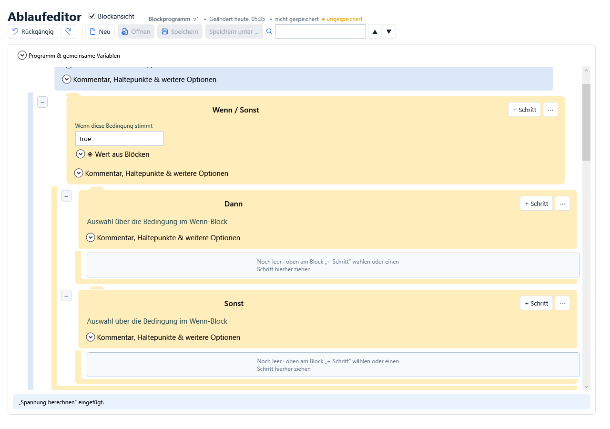
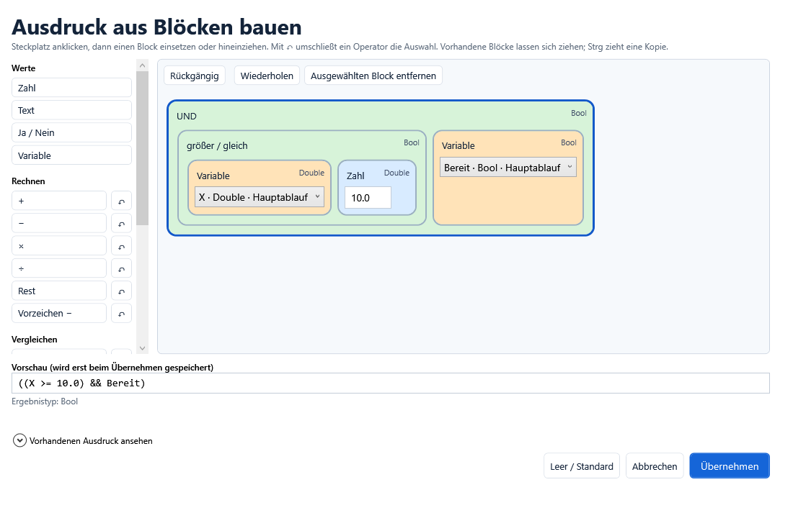

# Visuelle Blockprogrammierung

Ab Version 1.2.0 lässt sich ein Prüfprogramm direkt in seinen Ablaufblöcken
bearbeiten. Oben **Blockansicht** einschalten. Diese Ansicht hat keine
seitlichen Paletten oder Einstellungsfelder. Die klassische Darstellung bleibt
über denselben Schalter erreichbar. Beide bearbeiten dieselbe `.tproj.json`-Datei.

## In drei Schritten zum Ablauf

1. Am gewünschten Abschnitt oder Block **+ Schritt** anklicken und einen Baustein
   aus der passenden Kategorie wählen.
2. Werte direkt in die weißen Felder des Blocks eintragen, Auswahllisten öffnen
   oder Ja/Nein schalten. Den Namen oben im Block bearbeiten.
3. Für Berechnungen **◈ Wert aus Blöcken** öffnen und den Ausdruck an Ort und
   Stelle zusammensetzen. **Übernehmen** schreibt das Ergebnis in das Feld.

Bei einer Gruppe fügt **+ Schritt** am Ende dieser Gruppe ein; bei einem
normalen Schritt direkt dahinter. Vorhandene Blöcke können durch Ziehen auf der
farbigen Fläche verschoben werden: oberes Viertel = davor, unteres Viertel =
danach, Gruppenmitte oder leere Fläche = hinein. Texte lassen sich innerhalb
der Eingabefelder markieren; dadurch wird kein Ablaufblock verschoben.

Über **⋯** am Block lassen sich Schritte duplizieren, nach oben oder unten
verschieben, deaktivieren und löschen. Gruppen mit +/− einklappen. Start, Loop
und Ende bleiben feste Programmabschnitte. Rückgängig und Wiederholen stehen
oben bereit. Die Ausführung, Geräte und Codebausteine nutzen dieselbe Engine
wie die klassische Ansicht.

## Bedingungen, Wiederholungen und parallele Schritte

Die Kategorie **Steuerung** erscheint in der **Blockansicht und Knotenansicht**. Sie enthält diese Vorlagen:

| Vorlage | Verhalten |
| --- | --- |
| Wenn … | Gruppe nur bei erfüllter Bedingung ausführen |
| Wenn … dann … sonst | Bedingung einmal prüfen, danach genau einen Zweig ausführen |
| Wiederhole … mal | Gruppe zunächst dreimal wiederholen; Anzahl im Block ändern |
| Wiederhole solange … | Bedingung vor jeder Iteration; beginnt mit false |
| Wiederhole bis … | Bedingung nach der Iteration; beginnt mit true |
| Parallel ausführen | Direkte Kinder gleichzeitig starten und gemeinsam abwarten |

**Wenn/Sonst** zeigt seine Bedingung direkt im äußeren Block. Die gewünschten
Aktionen jeweils über **+ Schritt** in **Dann** oder **Sonst** einfügen. Die
Entscheidung bleibt fest, auch wenn der Dann-Zweig anschließend eine beteiligte
Eingangsvariable ändert. Bei der nächsten Ausführung wird erneut entschieden.

Im Dateiformat besteht die Vorlage weiterhin aus normalen Gruppen, einem
Entscheidungsschritt und einer lokalen booleschen Hilfsvariable mit Präfix
`_BlockZweig_`. Die einfache Ansicht blendet diesen Hilfsschritt aus und
bearbeitet dessen Ausdruck im äußeren Block. Wer diese Bestandteile im
klassischen Editor oder über Spezialoptionen bewusst verändert, verändert die
Programmlogik. Es wird keine zweite Laufzeitsprache eingeführt.

## Werte und Variablen einsetzen

Zielvariablen lassen sich aus einer Auswahlliste wählen. Bei Eingängen und
Berechnungen stehen unter **◈ Wert aus Blöcken** sichtbare Variablen sowie
Zahlen-, Text-, Ja/Nein-, Rechen-, Vergleichs- und Logikblöcke bereit.

1. Einen Steckplatz oder bestehenden Ausdrucksblock anklicken.
2. Einen passenden Werte- oder Operatorblock einsetzen. **↶** legt einen Operator
   um die aktuelle Auswahl.
3. Seine Eingänge mit Zahlen, Texten, Variablen oder weiteren Operatoren füllen.
4. Vorschau und Ergebnistyp prüfen und **Übernehmen** wählen.

Zahlen, Texte und Auswahlen werden innerhalb ihrer Ausdrucksblöcke bearbeitet.
Vorhandene Ausdrucksblöcke lassen sich ziehen; **Strg** zieht eine Kopie.
Unpassende Typen und leere Steckplätze verhindern die Übernahme.
**Abbrechen** verwirft den Entwurf. Das Einklappen allein speichert ihn nicht;
beim erneuten Aufklappen bleibt der noch offene Entwurf erhalten.
Rückgängig/Wiederholen im Baukasten betrifft seinen Entwurf; nach der Übernahme
wirkt wieder der Verlauf des Ablaufeditors.

`1` ist eine Ganzzahl, `1.0` beziehungsweise `1,0` eine Gleitkommazahl.
`3 / 2` ergibt deshalb 1, `3.0 / 2` ergibt 1.5. Text plus Text verbindet
Zeichenketten. Die Typprüfung führt keine Gerätezugriffe aus und liest keine
Laufzeitwerte. Wertabhängige Fehler wie Division durch null in der Simulation
prüfen. Ein Ausdruck ist auf 256 Knoten und 32 Ebenen begrenzt; größere bestehende
Ausdrücke bleiben im klassischen Texteditor bearbeitbar.

## Weitere Optionen bleiben im Block

**Variablen in dieser Gruppe** öffnet die Deklarationen innerhalb des
Gruppenblocks. Gemeinsame Variablen liegen oben unter
**Programm & gemeinsame Variablen**. Sichtbarkeit, Elternpfade (`../Name`) und
Bausteingrenzen entsprechen den Regeln des bisherigen Editors.

**Kommentar, Haltepunkte & weitere Optionen** öffnet selten benötigte
Einstellungen ebenfalls innerhalb des Blocks: mehrzeilige Kommentare,
Haltebedingungen, Speicherung, Ressourcen, Exit-Gruppe und Codewerkzeuge.
Bibliotheksbausteine zeigen ihre Auswahl und Ein-/Ausgänge direkt am Block.
Codebausteine enthalten weiterhin den Editor mit Zeilennummern.

Bei zwischenzeitlich veränderten Zielwerten oder gewechselten Projekten wird
ein offener Ausdrucksentwurf nicht ungeprüft darübergeschrieben. Unbekannte
Variablen oder ungültige bestehende Ausdrücke bleiben bis zu einer bewussten
Übernahme unverändert. Der klassische Editor bietet weiterhin den separaten
Ausdrucksdialog.

Ein ausführbares Beispiel ohne Hardware liegt unter
[Beispielprogramm](beispiele/blockprogrammierung/README.md).

## Verbundene Knoten statt gestapelter Karten

**Knotenansicht** ergänzt eine Arbeitsfläche mit manuell verbindbaren Anschlüssen,
Zoom und freiem Verschieben. Beim Debuggen erscheinen die aktuellen Variablenwerte
des bisherigen Haltepunkts daneben. [Bedienung der Knotenansicht](knotenansicht.md).

## Übersichtliche Auswahl in der normalen Ansicht

Die normale Ansicht bietet **Gruppe** als gemeinsamen Strukturbaustein. Eintrittsbedingung, Wiederholungsart und **Parallel ausführen** werden in den Gruppeneigenschaften eingestellt. Die sechs zusätzlichen Steuerungsvorlagen erscheinen dort nicht mehr; vorhandene Vorlagengruppen bleiben vollständig bearbeitbar.

Die Bausteinkategorien links lassen sich auf- und zuklappen. Struktur, Variablen, Ablauf und Werkerinteraktion sind anfangs geöffnet. Geräte-, Protokoll- und weitere Fachkategorien öffnen sich bei Bedarf. Mit **Bausteine suchen** kann nach Namen, Funktion, Protokoll oder interner Bausteinkennung gesucht werden. Alle eingegebenen Wörter müssen vorkommen. Trefferkategorien öffnen sich automatisch; ein leeres Suchfeld stellt die vollständige normale Auswahl wieder her.

In Block- und Knotenansicht bleiben alle Steuerungsvarianten im Einfügemenü verfügbar: Bedingung, Wenn/Dann/Sonst, feste Wiederholung, Solange/Bis und Parallel. Die Suche der normalen Seitenleiste schränkt diese visuellen Einfügemenüs nicht ein. Der Ansichtswechsel verändert weder den Ablauf noch den Undo-Verlauf.
