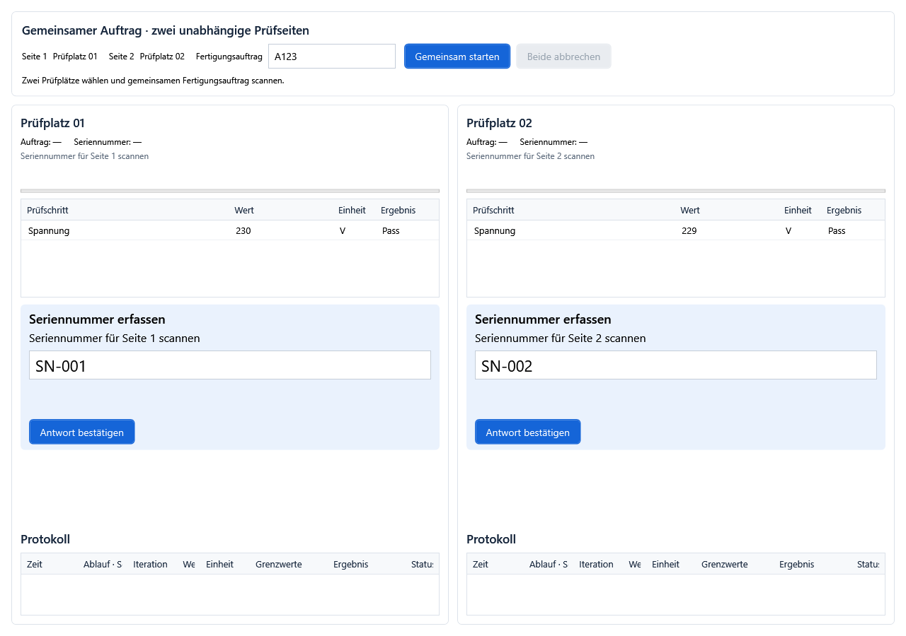

# Zwei Prüfplätze mit gemeinsamem Fertigungsauftrag

Stand: 12.10.2026 · Software: 1.0.12.0

Ein Fertigungsauftrag wird einmal ausgewertet. Beide Seiten verwenden das dadurch ausgewählte Prüfprogramm mit derselben Version und den gleichen Auswahlparametern. Jede Seite besitzt ihren eigenen Ablauf, ihre eigenen Variablen, Seriennummern, Messwerte und Eingaben. Start, Loop und End laufen je Seite. Die Freigabe zwischen den Seiten wird im Prüfprogramm festgelegt.

Die ausgewählte Programmversion bleibt für die gesamte gemeinsame Sitzung bestehen. Eine später neu freigegebene Version wird beim nächsten gemeinsamen Auftrag berücksichtigt.

Die Abbildung zeigt einen überprüften WPF-Anzeigezustand mit Beispieldaten. Beide Eingaben sind gleichzeitig sichtbar; eine Bestätigung beantwortet nur die zugehörige Seite.

## Einrichtung und Start

1. Unter **Prüfplatzkonfiguration** zwei Prüfplätze anlegen und die Geräte je Seite zuordnen. Gemeinsam verwendete Geräte als gemeinsam und mit erforderlicher Sperre konfigurieren.
2. Dasselbe Prüfprogramm mit derselben Version für beide Prüfplätze verfügbar machen. Im Produktionsbetrieb die Version freigeben.
3. Unter **Auswahl & Auftrag** die Auftragsauswertung für den ersten ausgewählten Prüfplatz konfigurieren. Diese Auswertung wird einmal verwendet und ihr Ergebnis für beide Seiten übernommen. Die Auswertung des zweiten Prüfplatzes wird für die gemeinsame Sitzung nicht zusätzlich ausgeführt.
4. Mit Entwicklerberechtigung unter **Einstellungen → Werkeransicht** die Option **Zwei Prüfplätze gemeinsam anzeigen** aktivieren, zwei verschiedene Prüfplätze auswählen und **Speichern und übernehmen** anklicken. Die Einstellung bleibt nach einem Neustart erhalten. Werker können die Anzeige und Seitenzuordnung nicht verändern. Änderungen sind erst nach Ende aller Prüfungen und Auftragssitzungen möglich.
5. Fertigungsauftrag scannen, beispielsweise **A123**, und **Gemeinsam starten** drücken oder Enter im Auftragsfeld verwenden.
6. Auf jeder Seite die eigene Seriennummer scannen und bestätigen. Das Eingabefeld der gewünschten Seite vor dem Scan auswählen. Neue Aufforderungen auf der anderen Seite übernehmen den Fokus nicht automatisch.

Wenn nur ein verfügbares Programm vorliegt und manuelle Auswahl erlaubt ist, wird dieses eindeutige Programm übernommen. Bei mehreren Kandidaten muss die Auftragsauswertung eindeutig ein Programm wählen. Eine fehlgeschlagene Zuordnung ohne erlaubte manuelle Auswahl startet keine Seite. Auswahl und Auftrag sind während der Sitzung gesperrt.

## Prüfprogramm aufbauen

Im Hauptablauf wird eine Variable **Auftrag** vom Typ **String** benötigt. Optional wird **Pruefseite** vom Typ **Int** mit 1 beziehungsweise 2 vorbelegt. Weitere Auswahlparameter und eine ausgewählte Python-Umgebung werden für beide Seiten übernommen; anschließend besitzt jede Seite ihren eigenen Variablenkontext.

Im endlos wiederholten Loop liegt eine Gruppe **Prüflingstest** mit einer eigenen String-Variable für die Seriennummer, beispielsweise **Kennung**. Als Seriennummernvariable der Gruppe ebenfalls Kennung auswählen. Ihr erster Schritt muss eine verpflichtende Werker-Eingabe vom Datentyp **Text** mit Ziel Kennung sein.

Für abwechselnde Prüfungen diese Schritte in der Prüflingsgruppe anordnen:

| Reihenfolge | Baustein | Einstellungen |
| --- | --- | --- |
| 1 | Werker-Eingabe | Seriennummer, Text, Pflicht, Ziel Kennung |
| 2 | Zwei Prüfplätze → Freigabe abwarten | Kanal Pruefung, ErsteSeite 1 |
| 3 | Eigentliche Prüfung | Eigene Messungen und Auswertung |
| 4 | Werker-Anweisung | Text „Prüfling entnommen“, auf Bestätigung warten |
| 5 | Zwei Prüfplätze → Andere Seite freigeben | Kanal Pruefung |

Seite 1 erhält die erste Freigabe. Seite 2 wartet nach ihrem Seriennummernscan. Sobald Seite 1 die Entnahme bestätigt und den Freigabebaustein erreicht, darf Seite 2 prüfen. Seite 1 kann inzwischen die nächste Seriennummer erfassen und wartet anschließend auf Seite 2. Diese Folge wiederholt sich im Loop.

**ErsteSeite 2** lässt die zweite Seite beginnen. Alle Wartebausteine desselben Kanals müssen denselben Wert verwenden. Eine Freigabe kann nur die Seite erteilen, die sie vorher erhalten hat. Weitere Kanalnamen ermöglichen getrennte Übergabestellen. Freigaben werden für jede neue Auftragssitzung neu angelegt. Diese Bausteine benötigen die gemeinsame Ansicht mit gestarteter Sitzung.

Die Position des Freigabebausteins bestimmt den Übergabezeitpunkt. Die Freigabe entsteht durch dessen Ausführung; PASS oder FAIL allein löst keine Übergabe aus. Den Baustein daher auf einem Ablaufpfad platzieren, der nach der gewünschten Bestätigung tatsächlich erreicht wird.

## Eingaben und zusätzliche Locks

Jede Seite lässt höchstens eine wartende Eingabe oder Bestätigung gleichzeitig beantworten. Weitere wartende Aufforderungen derselben Seite werden nacheinander aktiviert. Die andere Seite besitzt eine eigene Eingabesperre und kann gleichzeitig eine eigene Aufforderung bearbeiten.

Gruppen können über ihre bestehenden **Ressourcen/Sperren** gemeinsame Geräte oder eine Ressource für die Werker-Sperre, beispielsweise **Werker**, reservieren. Für eine seitenübergreifende Werker-Sperre diese Ressource unter Prüfplatzkonfiguration auf beiden Seiten demselben **gemeinsamen** Gerät und Kanal zuordnen und **Sperre erforderlich** aktivieren. Als reine Sperrressource kann ein gemeinsames Simulationsgerät verwendet werden; es benötigt keine Messschritte. Die betreffenden Interaktionen dann in Gruppen mit Ressource Werker setzen. Die Zuordnung muss auf beiden Seiten vorhanden sein; zwei lokale Geräte würden zwei getrennte Sperren ergeben. Ohne diese zusätzliche gemeinsame Sperre können beide Seiten unabhängig bedient werden.

Eine gemeinsame Ressource nur für den Abschnitt reservieren, der sie benötigt. Beim Warten auf die Freigabe keine Ressource halten, die die andere Seite zum Erreichen ihres Freigabeschritts benötigt. Entnahmebestätigung und Übergabe sinnvoll außerhalb einer langen gemeinsamen Gerätereservierung anordnen.

## Abbruch und Neustart

**Beide abbrechen** beendet die gemeinsame Sitzung auf beiden Seiten, einschließlich einer wartenden Freigabe. Auch das Ende oder der einseitige Abbruch eines Prüflaufs beendet den Partner. Die normalen End-Abschnitte werden dabei ausgeführt. Ein ausdrücklich erneut ausgelöster Werkerabbruch kann wie im Einzelbetrieb den aktuellen End-Abschnitt beenden; die automatische Partnerbeendigung löst diesen zweiten Abbruch nicht aus.

Anschließend den Fertigungsauftrag erneut scannen und gemeinsam starten. Die Auswahl wird neu ausgewertet. Beide Seiten beginnen mit eigenen neuen Seriennummern und frischen Freigaben.

## Beispielprojekt

[zwei-pruefplaetze.tproj.json](beispiele/zwei-pruefplaetze.tproj.json) zeigt die komplette Folge mit einer simulierten Bewertung. Es benötigt keine C#-DLL und keine realen Messgeräte. Für einen schnellen Versuch zwei Prüfplätze mit diesem Projekt verwenden und eindeutige Auswahl erlauben; A123 kann dann als gemeinsamer Auftrag gestartet werden. Die Bewertung ersetzt keine echte Messung. Für den produktiven Ablauf den Schritt **Simulierte Prüfung** durch die eigenen Prüfungen ersetzen.
